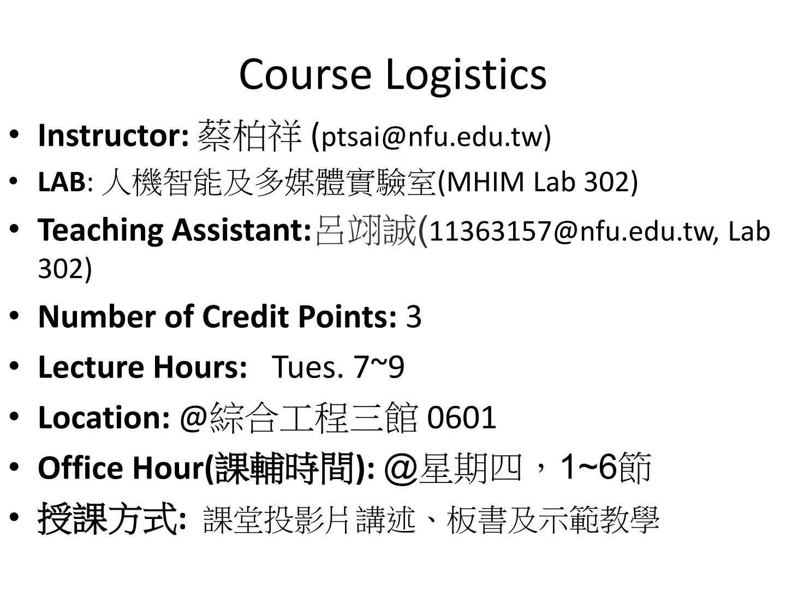
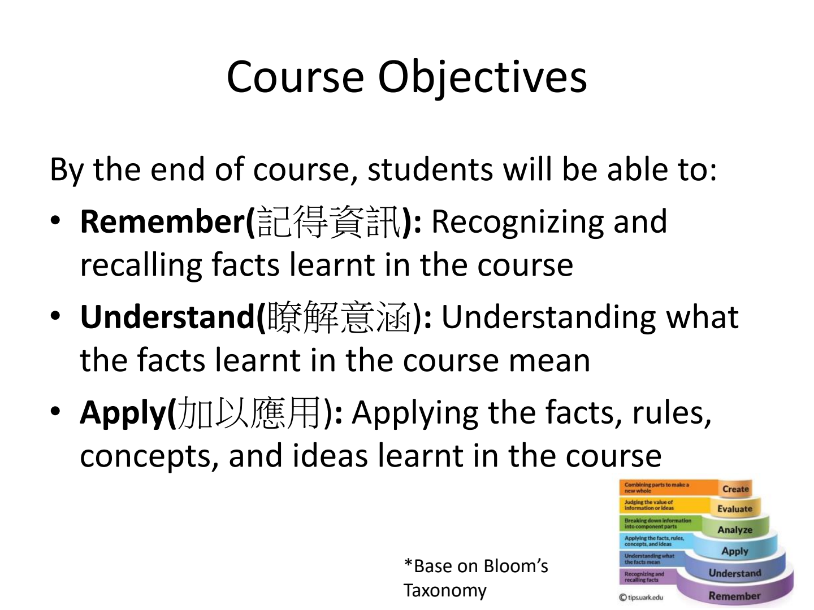
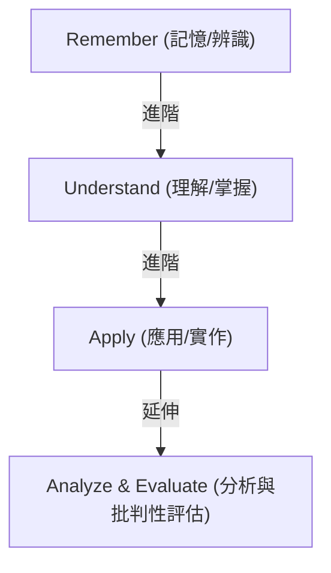
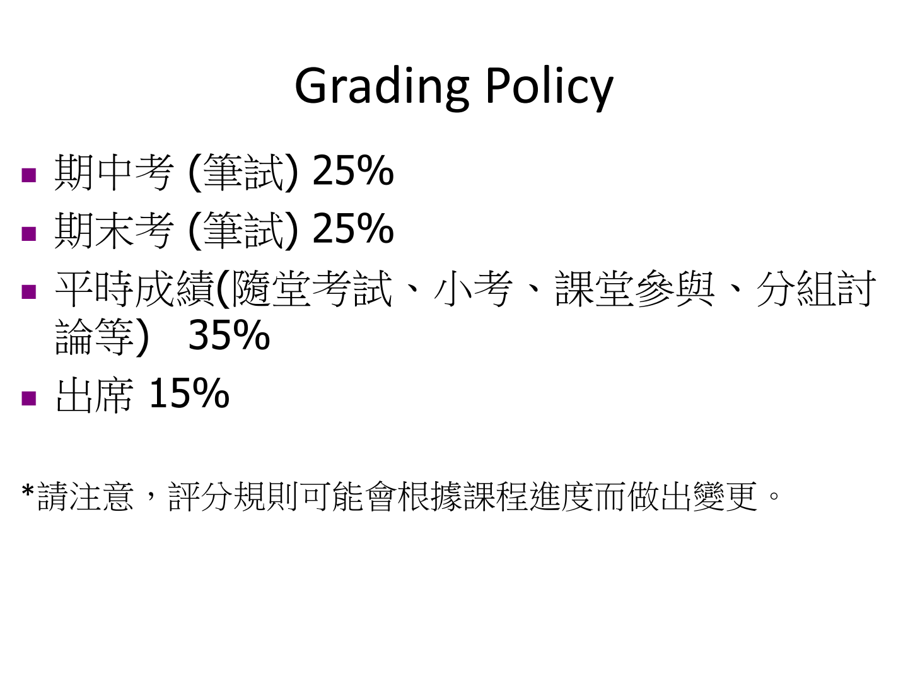
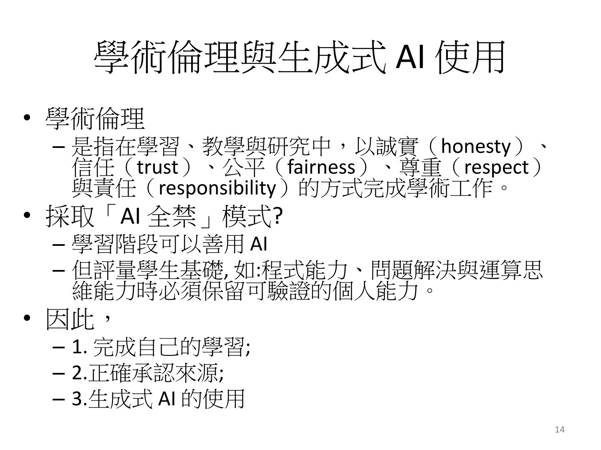
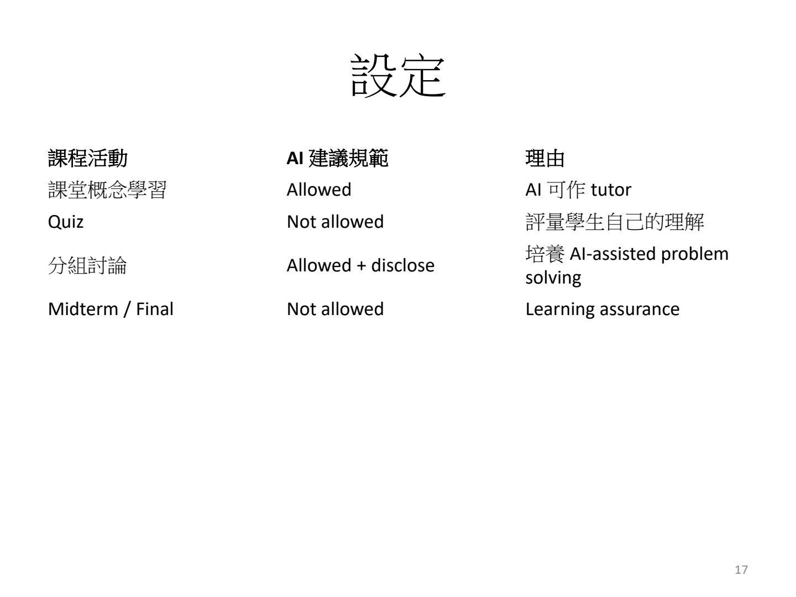

# Module 0: 課程大綱與學習指引 (Course Syllabus & Guide)

> **課程名稱**：資訊工程導論 (Introduction to Information Engineering)  
> **授課教師**：蔡柏祥 教授 (ptsai@nfu.edu.tw)  
> **研究室 / 實驗室**：人機智能及多媒體實驗室 (MHIM Lab 302)  
> **教學助理 (TA)**：呂翊誠 (11363157@nfu.edu.tw, Lab 302)  
> **學分數 / 時數**：3 學分 / 每週二 7~9 節 (@綜合工程三館 0601)  
> **課輔時間 (Office Hours)**：每週四 1~6 節 (需預約)  
> **指定教材**：*Computer Science: An Overview*, 13th Edition, J. Glenn Brookshear & Dennis Brylow, Pearson / Addison Wesley (滄海圖書代理，中英文版)

---

## 📑 目錄 (Table of Contents)
1. [課程簡介與目標 (Course Description & Objectives)](#1-課程簡介與目標-course-description--objectives)
2. [評分標準與考核方式 (Grading Policy)](#2-評分標準與考核方式-grading-policy)
3. [18 週預定課程進度表 (18-Week Course Schedule)](#3-18-週預定課程進度表-18-week-course-schedule)
4. [學術倫理與生成式 AI 使用規範 (Academic Ethics & GenAI Guidelines)](#4-學術倫理與生成式-ai-使用規範-academic-ethics--genai-guidelines)
5. [先備知識與學習資源 (Prerequisites & Resources)](#5-先備知識與學習資源-prerequisites--resources)
6. [專業術語中英對照表 (Bilingual Terminology Table)](#6-專業術語中英對照表-bilingual-terminology-table)

---

## 1. 課程簡介與目標 (Course Description & Objectives)

### 課程核心理念 (Course Philosophy)
本課程旨在幫助資訊工程系大一新生建立對**資訊工程 (Information Engineering)** 與**計算機科學 (Computer Science)** 全貌的宏觀視野與底層思維。從基礎的演算法、程式邏輯、軟體工程，一路延伸至資料抽象化與資料庫系統，為後續進階專業必修課奠定扎實根基。

### 布魯姆認知領域教學目標 (Bloom's Taxonomy)
本課程依據布魯姆認知層級理論 (Bloom's Taxonomy)，引導學生由淺入深達成以下三大認知能力：

1. **記得資訊 (Remember)**：
   - *定義*：能精確識別 (Recognize) 與回憶 (Recall) 課堂所學的關鍵名詞、定義、硬體架構與計算機歷史里程碑。
2. **瞭解意涵 (Understand)**：
   - *定義*：能理解 (Comprehend) 事實背後的運作機制與概念意涵，例如演算法為何能終止、抽象化如何隔離複雜度。
3. **加以應用 (Apply)**：
   - *定義*：能將課堂所學之規則 (Rules)、觀念 (Concepts) 與演算法思維應用於解決具體的運算與程式設計問題。

---

## 2. 評分標準與考核方式 (Grading Policy)

本課程注重課堂即時反饋、自主思考與階段性能力考核。評分比例規劃如下：

| 評量項目 (Assessment) | 佔比 (Weight) | 詳細說明 (Description) |
| :--- | :---: | :--- |
| **期中考 (Midterm Exam)** | **25%** | 紙筆測驗，考核前半學期（Overview、Algorithms、Programming Languages）核心觀念與計算題。 |
| **期末考 (Final Exam)** | **25%** | 紙筆測驗，考核後半學期（Software Engineering、Data Abstractions、Database Systems）整合能力。 |
| **平時成績 (Continuous Assessment)** | **35%** | 涵蓋隨堂測驗 (Pop Quiz)、單元小考 (Quiz 1~4)、課堂參與 (Engagement) 及分組專題討論 (Group Discussion)。 |
| **課堂出席 (Attendance)** | **15%** | 每週點名與課堂互動出席紀錄。 |

> ⚠️ **注意事項**：評分規則得由授課教師依據實際學習進度與全班學習成效進行微調。

---

## 3. 18 週預定課程進度表 (18-Week Course Schedule)

本學期共計 18 週，涵蓋課本對應章節與重要考評節奏：

| 週次 (Week) | 教學單元 (Topic / Module) | 課本對應章節 | 重點活動與備註 (Notes / Quizzes) |
| :---: | :--- | :--- | :--- |
| **第 01 週** | 課程介紹與學術倫理規範 (Syllabus & Ethics) | Module 0 | 課程架構、評分說明、AI 使用原則宣導 |
| **第 02 週** | 計算機科學緒論 (CS Overview) | Chapter 0 | 演算法本質、計算機硬體演進、九大核心主題 |
| **第 03 週** | 緒論回顧與評量 (Overview Review) | Chapter 0 | **隨堂測驗 (Pop Quiz)** |
| **第 04 週** | 演算法探索與結構 (Algorithms Exploration) | Chapter 5 | 虛擬碼、流程控制、**分組討論 (Group Discussion)** |
| **第 05 週** | 演算法分析與複雜度 (Algorithm Complexity) | Chapter 5 | **小考 1 (Quiz 1)** |
| **第 06 週** | 程式語言基礎 (Programming Languages) | Chapter 6 | 語法結構、編譯與直譯、**隨堂測驗 (Pop Quiz)** |
| **第 07 週** | 程式語言典範 (Language Paradigms) | Chapter 6 | **分組討論 (Group Discussion)** |
| **第 08 週** | 程式語言實務與應用 (PL Applications) | Chapter 6 | **小考 2 (Quiz 2)** |
| **第 09 週** | **期中考試 (Midterm Examination)** | **Ch 0, 5, 6** | **課堂實體筆試 (25%)** |
| **第 10 週** | 軟體工程導論 (Software Engineering) | Chapter 7 | 生命週期模型、敏捷開發、需求分析 |
| **第 11 週** | 軟體架構與設計模式 (Design Patterns) | Chapter 7 | **隨堂測驗 (Pop Quiz) & 分組討論** |
| **第 12 週** | 軟體測試與維護 (Testing & Maintenance) | Chapter 7 | 單元測試、驗證與確認 (V&V) |
| **第 13 週** | 資料抽象化概念 (Data Abstractions) | Chapter 8 | 基本資料結構、ADT、**小考 3 (Quiz 3)** |
| **第 14 週** | 進階資料結構 (Trees & Graphs) | Chapter 8 | **隨堂測驗 (Pop Quiz)** |
| **第 15 週** | 資料結構實作討論 (Implementation) | Chapter 8 | **分組討論 (Group Discussion)** |
| **第 16 週** | 資料庫系統概論 (Database Systems) | Chapter 9 | 關聯式模型、SQL 語法、**小考 4 (Quiz 4)** |
| **第 17 週** | 資料庫設計與正規化 (Normalization) | Chapter 9 | ER Model、ACID 特性、系統整合 |
| **第 18 週** | **期末考試 (Final Examination)** | **Ch 7, 8, 9** | **課堂實體筆試 (25%)** |

---

## 4. 學術倫理與生成式 AI 使用規範 (Academic Ethics & GenAI Guidelines)

在人工智慧普及的世代，建立負責任的學術倫理與技術素養至關重要。

### 學術倫理五大核心價值 (Five Pillars of Academic Integrity)
1. **誠實 (Honesty)**：真實呈現自己的學習成果，不抄襲、不作假。
2. **信任 (Trust)**：建立師生與同儕間互相尊重的學術信任機制。
3. **公平 (Fairness)**：維持公平競爭與客觀公正的評量環境。
4. **尊重 (Respect)**：尊重他人智慧財產權與學術貢獻。
5. **責任 (Responsibility)**：對自己產出與發表的每行程式碼與論點負全責。

### 生成式 AI 政策：拒絕「全禁」，倡導「智慧協作」
本課程不採取「AI 全禁 (Total Ban)」策略，而是明確定義生成式 AI 的定位：

> **關鍵準則**：  
> AI 扮演的是 **學習輔助者 (Tutor)**，而不是 **答案產生器 (Answer Generator)**！  
> **「AI 可以幫助你學習，但不能取代你學會。」**

#### 各項教學活動之 AI 規範準則：
| 課程活動類別 | AI 規範 (Policy) | 核心理由與規範細節 (Rationale & Disclosure) |
| :--- | :---: | :--- |
| **課堂概念學習** | **允許 (Allowed)** | AI 可充當 24 小時個人家教，協助釐清抽象觀念與語法疑問。 |
| **隨堂測驗 (Pop Quiz)** | **禁止 (Not Allowed)** | 檢驗學生個人的即時理解力與吸收程度。 |
| **分組討論 (Group Discussion)** | **允許並揭露 (Allowed + Disclose)** | 培養 AI 協作解題能力；報告時必須透明陳述所用工具、Prompt 與自身驗證修正過程。 |
| **期中考 / 期末考** | **禁止 (Not Allowed)** | 學習確證 (Learning Assurance)，保障個人獨立思考與真實專業技能。 |

#### AI 使用的兩大標準作業流程 (SOP)：
1. **透明揭露流程**：  
   $$\text{Tool (使用工具)} \longrightarrow \text{Purpose (使用目的)} \longrightarrow \text{Use (具體用法)} \longrightarrow \text{Verification (人工驗證)}$$
2. **負責任檢驗流程**：  
   $$\text{Understand (理解)} \longrightarrow \text{Test (測試)} \longrightarrow \text{Verify (驗證)} \longrightarrow \text{Decide (決策)}$$

#### 提交作業前自我提問 (The Golden Question)：
> *"Can I explain how this works and why I made these decisions?"*  
> （我是否能清楚解釋這段程式碼的運作原理，以及為何我做出這樣的架構決策？）

#### 延伸反思：過度依賴 AI 對大腦的影響
- **MIT 認知研究警告**：過度依賴 AI 產生現成答案，會使大腦產生「安靜腦波 (Quiet Brain Waves)」，導致認知參與度與長期記憶留存率顯著下降。
- **腦科學觀點**：人類大腦前額葉直到 25 歲左右才完全發育成熟，大學階段是訓練邏輯思維與獨立推論的黃金期，切勿讓 AI 取代自身大腦的運算與鍛鍊。

---

## 5. 先備知識與學習資源 (Prerequisites & Resources)

### 先備知識 (Pre-requisites)
- **英語閱讀能力 (English Proficiency)**：能閱讀基礎英文專有名詞、教材段落與程式語言語法。
- **基礎科技素養 (Technological Knowledge)**：理解作業系統基本操作、檔案管理與網際網路基礎概念。
- **程式概念接觸 (Programming Exposure)**：對程式語言（如 Python、C 或 Scratch）有初步概念或濃厚學習熱忱。

### 學習平台與支援機制
- **校內教學平台 (u-Learn)**：課程講義下載、作業繳交、公告與同儕討論區。
- **助教時間 (TA Hours)**：
  - 實體輔導：MHIM Lab 302
  - 線上答疑：透過 Email (11363157@nfu.edu.tw) 與 u-Learn 論壇。
- **教師預約 (Office Hours)**：每週四 1~6 節開放預約深入諮詢。

---

## 6. 專業術語中英對照表 (Bilingual Terminology Table)

| 英文術語 (English Term) | 繁體中文對照 (Traditional Chinese) | 詳細定義與專業意涵 (Definition & Context) |
| :--- | :--- | :--- |
| **Syllabus** | 課程大綱 | 記載課程目標、進度、評分準則、先備條件與作業規範的正式指導文件。 |
| **Bloom's Taxonomy** | 布魯姆認知領域教學目標 | 將教育目標分為記憶、理解、應用、分析、評鑑與創造六個層次的分類框架。 |
| **Academic Ethics** | 學術倫理 | 在教學、研究與學習中恪守誠實、公平、尊重與責任感的道德規範。 |
| **Academic Integrity** | 學術誠信 | 堅持獨立思考、禁止抄襲、偽造數據與非授權協作的學術基本守則。 |
| **Generative AI (GenAI)** | 生成式人工智慧 | 能夠透過深度學習模型自動生成文字、程式碼、影像或音訊之新一代 AI 技術。 |
| **Tutor vs Answer Generator** | 家教 vs 答案產生器 | AI 應作為啟發思考、引導解題的家教，而非直接抄襲獲取答案的工具。 |
| **Transparency & Disclosure** | 透明度與揭露原則 | 主動公開在作業或研究中所使用的 AI 工具、提詞策略及介入程度。 |
| **Learning Assurance** | 學習確證 | 評量機制確保每位學生確實掌握必備核心專業能力與實作技巧。 |
| **Office Hours** | 課輔時間 / 教師諮詢時間 | 授課教師固定於研究室開放學生個別請益課業、生涯或專題的時段。 |
| **Pre-requisites** | 先備知識 / 預備條件 | 修習特定高階課程前，學生必須事先具備的基礎知識或修畢之先修科目。 |
