# Module 1: 計算機科學緒論與核心思維 (Introduction to Computer Science)

> **對應課本章節**：Chapter 0: Introduction (Brookshear & Brylow, 13th Edition)  
> **核心目標**：理解計算機科學的本質、計算工具演進史、九大核心主題，以及 AI 時代下的程式思維與社會倫理。

---

## 📑 目錄 (Table of Contents)
1. [演算法的作用與核心詞彙鏈 (Terminology Pipeline)](#1-演算法的作用與核心詞彙鏈-terminology-pipeline)
2. [演算法的五大特性 (Five Essential Properties of Algorithms)](#2-演算法的五大特性-five-essential-properties-of-algorithms)
3. [經典案例：歐幾里得輾轉相除法 (Euclidean Algorithm for GCD)](#3-經典案例歐幾里得輾轉相除法-euclidean-algorithm-for-gcd)
4. [計算機發展史：六大演進階段 (History of Computing)](#4-計算機發展史六大演進階段-history-of-computing)
5. [現代與未來計算趨勢 (Modern & Emerging Computing Trends)](#5-現代與未來計算趨勢-modern--emerging-computing-trends)
6. [包羅萬象的九大計算機科學主題 (Nine Big Ideas in CS)](#6-包羅萬象的九大計算機科學主題-nine-big-ideas-in-cs)
7. [程式化典範演進與 AI 時代的 CS 價值 (Evolution of Programming & AI Era)](#7-程式化典範演進與-ai-時代的-cs-價值-evolution-of-programming--ai-era)
8. [倫理道德四大哲學框架 (Four Ethical Frameworks)](#8-倫理道德四大哲學框架-four-ethical-frameworks)
9. [綜合實務案例：Google Maps 串聯九大主題](#9-綜合實務案例google-maps-串聯九大主題)
10. [專業術語中英對照表 (Bilingual Terminology Table)](#10-專業術語中英對照表-bilingual-terminology-table)

---

## 1. 演算法的作用與核心詞彙鏈 (Terminology Pipeline)

在進入資訊工程的領域時，最關鍵的是釐清從**現實問題**到**硬體執行**之間的各個抽象層級：

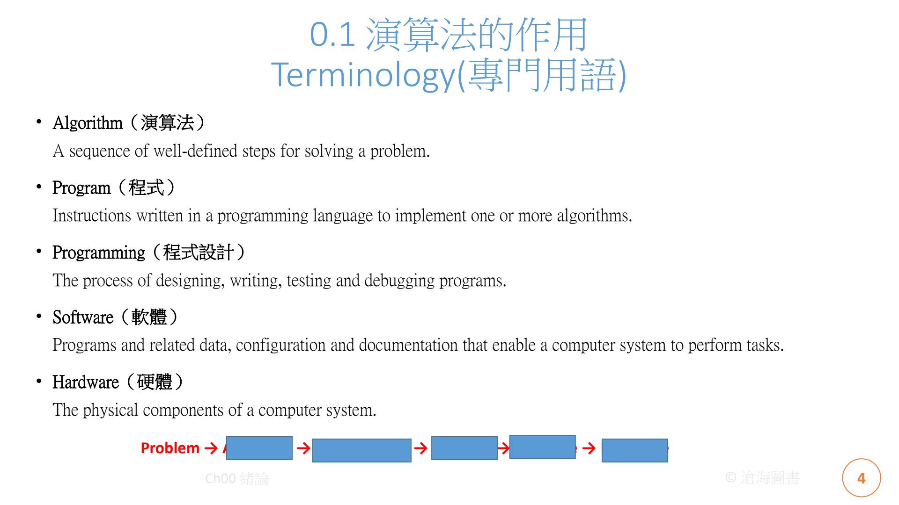

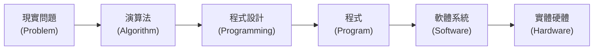

### 核心定義對照 (Core Definitions)

1. **問題 (Problem)**：
   - *定義*：待解決的目標、任務或運算需求（例如：「找出兩數的最大公因數」、「在最短時間內從台北導航至高雄」）。
2. **演算法 (Algorithm)**：
   - *英文定義*：*A sequence of well-defined steps for solving a problem.*
   - *中文解析*：為了解決特定問題所設計的一連串定義嚴謹、順序明確且可執行的有限步驟。演算法是抽象的邏輯，獨立於任何具體硬體或程式語言。
3. **程式設計 (Programming)**：
   - *英文定義*：*The process of designing, writing, testing and debugging programs.*
   - *中文解析*：將演算法的抽象概念轉換為計算機能理解的指令碼之完整工程過程，包含軟體架構設計、編碼 (Coding)、測試 (Testing) 與除錯 (Debugging)。
4. **程式 (Program)**：
   - *英文定義*：*Instructions written in a programming language to implement one or more algorithms.*
   - *中文解析*：使用特定程式語言（如 Python、C++、Java）撰寫的靜態指令集合，用以實作一個或多個演算法。
5. **軟體 (Software)**：
   - *英文定義*：*Programs and related data, configuration and documentation that enable a computer system to perform tasks.*
   - *中文解析*：不僅僅是程式碼本身，還包含執行所需的資料 (Data)、組態設定 (Configurations)、依賴庫以及完整技術文件 (Documentation) 的集合體。
6. **硬體 (Hardware)**：
   - *英文定義*：*The physical components of a computer system.*
   - *中文解析*：構成計算機系統的實體物理設備，包括中央處理器 (CPU)、記憶體 (RAM)、硬碟 (Storage)、匯流排 (Bus) 與輸入輸出設備 (I/O Devices)。

---

## 2. 演算法的五大特性 (Five Essential Properties of Algorithms)

電腦科學大師高德納 (Donald Knuth) 在《電腦程式設計藝術》中明確規範了演算法必須滿足的五大準則：

| 特性 (Property) | 英文規範 | 詳細說明 (Explanation) | 違反時的常見現象 |
| :--- | :--- | :--- | :--- |
| **1. 輸入 (Input)** | *Zero or more quantities are externally supplied.* | 演算法必須有 0 個或多個明確定義的外部輸入資料。輸入值必須屬於特定的有效集合。 | 輸入格式不明確、邊界未定義。 |
| **2. 輸出 (Output)** | *At least one quantity is produced.* | 演算法執行完畢後，必須產生至少一個輸出結果，作為對輸入問題的解答或狀態回饋。 | 程式執行完畢毫無任何回傳或效果。 |
| **3. 明確性 / 確定性 (Definiteness)** | *Each step must be clear and unambiguous.* | 每一個步驟的意義必須是唯一且無二義性的。在相同的輸入條件下，每次執行的動作必須完全一致。 | 使用模糊指令（如「加入適量鹽巴」）。 |
| **4. 有效性 / 可行性 (Effectiveness)** | *Operations must be basic enough to be done exactly.* | 每個指令必須足夠基礎且可行，理論上能夠由人使用紙筆在有限時間內精確完成。 | 要求「算出所有無限質數」。 |
| **5. 有限性 / 終結性 (Finiteness)** | *The algorithm must terminate after a finite number of steps.* | 對於任何合法的輸入，演算法都必須在經過有限個步驟與有限時間內停止執行。 | 陷入無窮迴圈 (Infinite Loop)。 |

---

## 3. 經典案例：歐幾里得輾轉相除法 (Euclidean Algorithm for GCD)

歐幾里得輾轉相除法（西元前約 300 年）是人類歷史上記錄最早、最優雅的經典演算法之一，用於求得兩正整數 $M$ 與 $N$ 的**最大公因數 (Greatest Common Divisor, GCD)**。

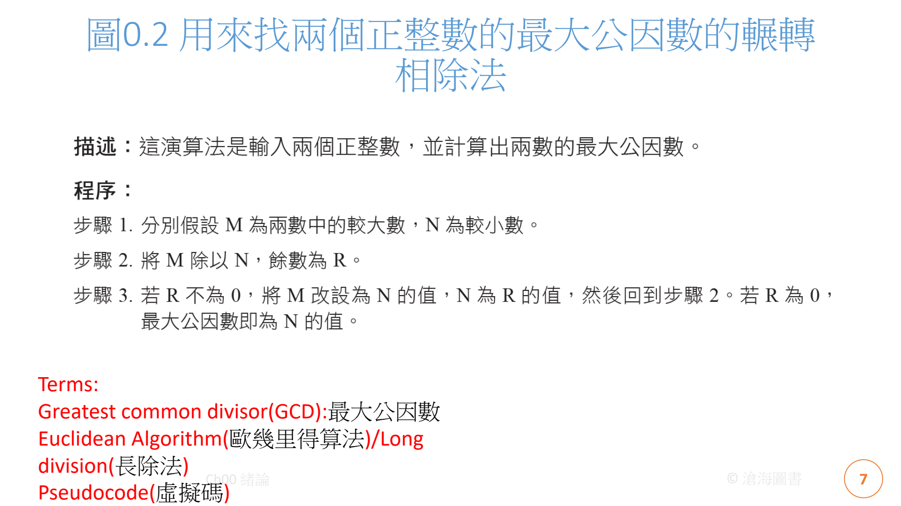

### 數學原理與推論
若整數 $d$ 能整除 $M$ 且能整除 $N$，則 $d$ 必能整除 $M - q \times N$（其中 $q$ 為商數）。  
因此：
$$\gcd(M, N) = \gcd(N, M \bmod N)$$

### 演算法流程與虛擬碼 (Pseudocode)

```text
Procedure Euclidean_GCD(M, N):
    While N != 0:
        R = M mod N    // 取 M 除以 N 的餘數
        M = N          // 將除數換作新的被除數
        N = R          // 將餘數換作新的除數
    End While
    Return M           // 當餘數為 0 時，此時的 M 即為最大公因數
```

### 實例推演追蹤 (Step-by-Step Trace: M = 24, N = 16)

| 步驟 (Step) | 被除數 ($M$) | 除數 ($N$) | 餘數 ($R = M \bmod N$) | 動作與說明 |
| :---: | :---: | :---: | :---: | :--- |
| **初始** | 24 | 16 | - | 檢查 $N \ne 0$，進入迴圈 |
| **Step 1** | 24 | 16 | $24 \bmod 16 = \mathbf{8}$ | 計算餘數 $R=8$；令 $M=16, N=8$ |
| **Step 2** | 16 | 8 | $16 \bmod 8 = \mathbf{0}$ | 計算餘數 $R=0$；令 $M=8, N=0$ |
| **終止** | **8** | **0** | - | 偵測到 $N=0$，跳出迴圈，輸出結果 **GCD = 8** |

### Python 程式碼實作
可在本專案 [`code_examples/gcd_euclidean.py`](file:///c:/Nono/Intro.%20to%20Info.%20Eng/code_examples/gcd_euclidean.py) 中直接執行：

```python
def gcd_modulo(m: int, n: int) -> int:
    while n != 0:
        m, n = n, m % n
    return m

print(gcd_modulo(24, 16)) # 輸出: 8
```

---

## 4. 計算機發展史：六大演進階段 (History of Computing)

計算工具從古代的機械輔助，歷經機電革命，演變至現代的微晶片與量子時代：

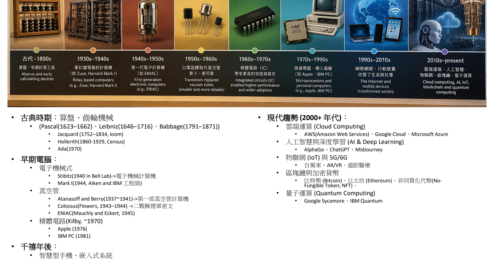

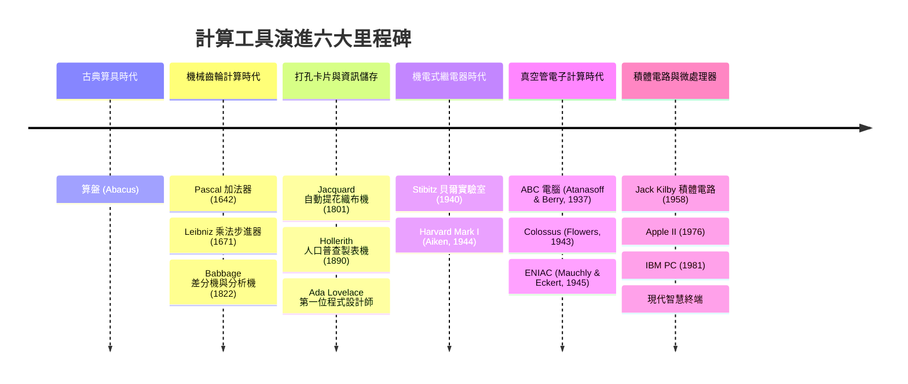

### 六大階段詳細解析

1. **古典算具 (Abacus)**：
   - 最早的人工計算工具，利用算珠的位置儲存數值並進行十進位或十六進位的四則運算。
2. **齒輪機械式計算機 (Mechanical Gear-driven Calculators)**：
   - **Blaise Pascal (1623–1662)**：發明 Pascaline 加法器，利用精密的齒輪嚙合實現自動進位。
   - **Gottfried Wilhelm Leibniz (1646–1716)**：發明步進計算器 (Stepped Reckoner)，透過圓柱齒輪實現乘除法運算，並確立二進位制哲學。
   - **Charles Babbage (1791–1871)**：計算機之父，設計**差分機 (Difference Engine)** 產生精確對數表，並構想出**分析機 (Analytical Engine)**，具備儲存體 (Store) 與運算單元 (Mill)，奠定現代電腦基本架構。
3. **穿孔卡片與自動控制 (Punched Cards & Tabulation)**：
   - **Joseph Marie Jacquard (1752–1834)**：利用穿孔卡片控制提花織布機，首創將「程式碼/指令」與「機器」分離的思想。
   - **Herman Hollerith (1860–1929)**：發明穿孔卡片製表機，大幅縮短 1890 年美國人口普查耗時（從 8 年縮短至 1 年內），該公司後來合併發展為 **IBM**。
   - **Ada Lovelace (1815–1852)**：世界首位程式設計師，為巴貝奇分析機撰寫了計算伯努利數的演算法，並洞見機器不僅能處理數字，更能處理符號與音樂。
4. **機電式繼電器計算機 (Electromechanical Relays)**：
   - **George Stibitz (1940)**：於貝爾實驗室利用繼電器 (Relays) 建造複數計算機 (Complex Number Computer)，展示遠端終端機連線運算。
   - **Howard Aiken & IBM (1944)**：建造 Harvard Mark I，長達 15 公尺的大型機電計算機，利用軸桿與繼電器運算。
5. **真空管電子計算機 (Vacuum Tube Electronic Computers)**：
   - **John Atanasoff & Clifford Berry (1937–1941)**：打造 ABC (Atanasoff-Berry Computer)，首部採用真空管 (Vacuum Tube)、電容記憶體與二進位制的電子運算裝置。
   - **Tommy Flowers (1943–1944)**：建造 **Colossus (巨人機)**，於英國二戰布萊切利園區成功破解德軍頂級 Lorenz 密碼機。
   - **John Mauchly & J. Presper Eckert (1945)**：打造著名的 **ENIAC**，世界上第一部通用型全電子計算機，內含近 18,000 支真空管，每秒可執行 5,000 次加法。
6. **積體電路與微處理器 (Integrated Circuits & Microprocessors)**：
   - **Jack Kilby & Robert Noyce (1958/1970)**：發明積體電路 (IC)，將電晶體、電阻與電容整合在單一矽晶圓上。
   - **個人電腦革命**：Apple II (1976)、IBM PC (1981)，使電腦從實驗室專用巨獸普及走入家庭與辦公室。

---

## 5. 現代與未來計算趨勢 (Modern & Emerging Computing Trends)

進入千禧年後，計算機科學跳脫單機限制，迎來五大革命性趨勢：

1. **雲端運算 (Cloud Computing)**：
   - 藉由高度虛擬化與全球資料中心，將算力、儲存與網路作為公用事業提供服務（代表廠商：AWS、Google Cloud Platform、Microsoft Azure）。
2. **人工智慧與深度學習 (AI & Deep Learning)**：
   - 從專家系統跨越到以大數據和深度神經網路驅動的自主學習（例如 AlphaGo 擊敗圍棋世界冠軍、ChatGPT 大型語言模型、Midjourney 影像生成）。
3. **物聯網與新世代通訊 (IoT & 5G/6G)**：
   - 全球數百億智慧感測器互聯，促進智慧城市、自動駕駛 (Self-driving Cars)、遠距醫療與沉浸式虛擬實境 (AR/VR/XR) 的實踐。
4. **區塊鏈與去中心化科技 (Blockchain & Cryptography)**：
   - 基於分散式帳本與密碼學保證防篡改機制，延伸出比特幣 (Bitcoin)、以太坊智慧合約 (Smart Contracts) 與非同質化代幣 (NFT)。
5. **量子運算 (Quantum Computing)**：
   - 利用量子疊加 (Superposition) 與量子糾纏 (Entanglement) 原理，以量子位元 (Qubits) 實現對特定 NP-Hard 難題（如大質數分解、量子化學模擬）的超指數加速（代表研發：Google Sycamore、IBM Quantum）。

### 摩爾定律 (Moore's Law)
> **定義**：Intel 共同創辦人 Gordon Moore 於 1965 年提出：**積體電路上可容納的電晶體數量，約每 18 至 24 個月翻倍，而成本減半。**  
> 摩爾定律推動了半世紀以來的數位繁榮，如今隨著物理極限（量子穿隧效應、散熱瓶頸），運算發展正轉向異質架構（GPU、TPU、NPU）與神經形態計算。

---

## 6. 包羅萬象的九大計算機科學主題 (Nine Big Ideas in CS)

計算機科學不僅僅是「寫程式」，它是一個跨越哲學、工程與數學的宏大知識體系。本課程將傳統的七大想法 (7 Big Ideas) 擴展至現代 **九大核心主題**：

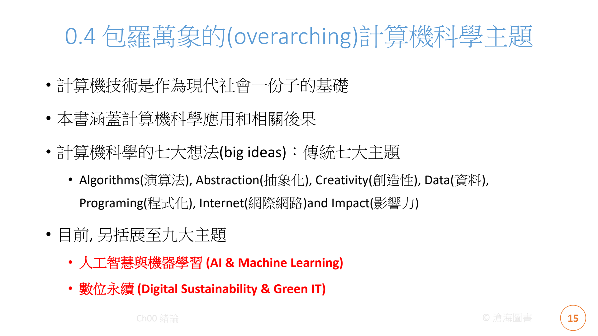

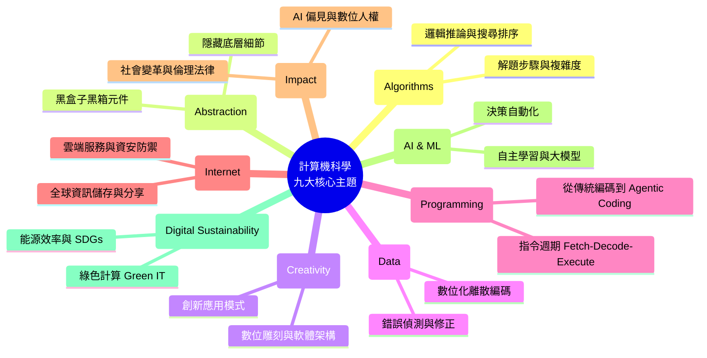

### 深入焦點：抽象化 (Abstraction)

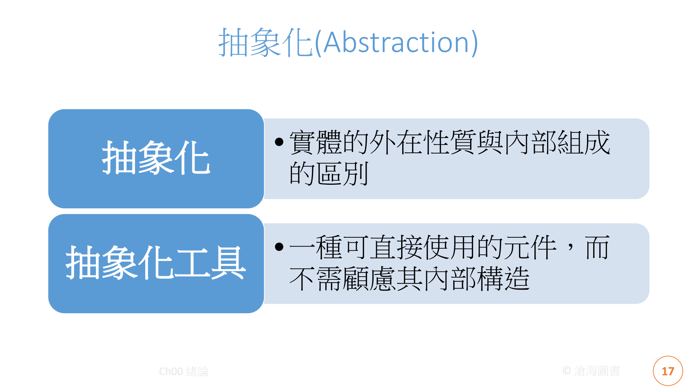

- **抽象化的定義**：刻意隱藏複雜系統的內部物理細節，僅對外呈現簡潔、標準且易於操作的介面 (Interface)。
- **抽象化工具 (Abstraction Tool)**：一種「可直接使用而毋須理解其內部繁雜電路或微指令的黑盒子 (Black Box) 元件」。
  - *生活比喻*：駕駛開車踩油門前進，無需懂得內燃機四行程爆炸或電子噴射控制單元的底層物理。
  - *軟體範例*：呼叫 `math.sqrt(x)` 計算平方根，開發者無需手動實作牛頓疊代法。

---

## 7. 程式化典範演進與 AI 時代的 CS 價值 (Evolution of Programming & AI Era)

### 計算機底層指令循環 (Instruction Cycle)
任何高階語言程式最終轉為機器碼後，CPU 均遵循四大基本循環：
$$\mathbf{Fetch (擷取)} \longrightarrow \mathbf{Decode (解碼)} \longrightarrow \mathbf{Execute (執行)} \longrightarrow \mathbf{Write\text{-}back (寫回)}$$

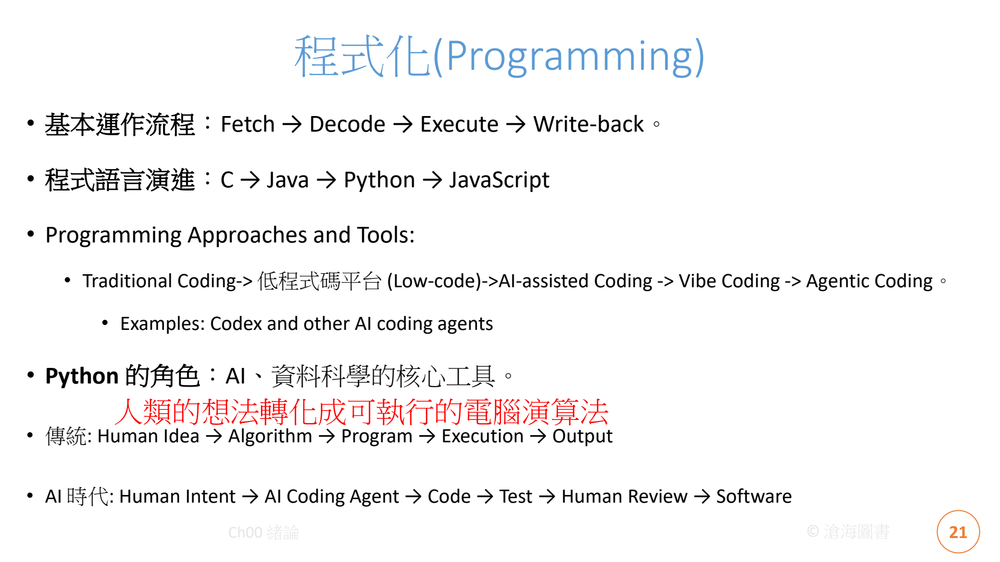

### 程式開發典範的五大代際演進 (Evolution of Coding Paradigms)
1. **傳統編程 (Traditional Coding)**：工程師純手工撰寫每一行語法 (C, Java, Python)。
2. **低程式碼 / 無程式碼 (Low-Code / No-Code)**：以圖形拖拉組件快速建構企業表單與流程。
3. **AI 輔助開發 (AI-Assisted Coding)**：IDE 整合自動補全建議 (GitHub Copilot, Tabnine)。
4. **直覺共感編程 (Vibe Coding)**：開發者以口語化 Prompt 描摹系統輪廓，由 AI 即時生成程式雛型。
5. **自主代理程式設計 (Agentic Coding)**：AI 具備自主呼叫終端機、閱讀文件、自我修錯 (Self-debugging) 與部署測試的多步驟執行能力。

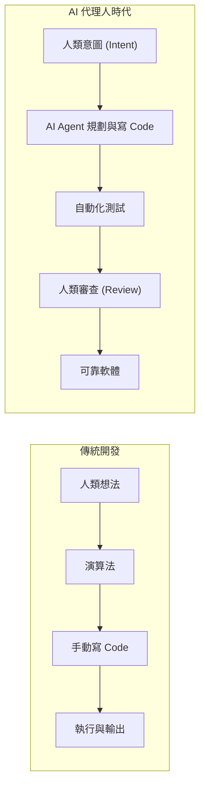

### 關鍵思辨：如果 AI 會寫程式，我們為什麼還要學計算機科學？
> **"Don't compete with AI at typing code. Learn to think at a level above the code."**  
> （切勿與 AI 競爭打字敲鍵盤的速度，要在程式碼之上更高層次的抽象思維維度競爭。）

當 AI 能輕鬆生成程式碼時，計算機科學家的核心價值在於：
1. **問題定義能力 (Problem Formulation)**：釐清模糊的現實需求，轉化為嚴謹的數學與運算模型。
2. **演算法驗證與審查 (Algorithm Verification)**：判斷 AI 產生的演算法在最壞情況下是否會崩潰？邏輯是否正確？
3. **資安與隱私防護 (Security & Privacy Risks)**：檢查是否有 SQL Injection、記憶體洩漏或機密資料外洩風險。
4. **系統級思考 (System Thinking)**：宏觀架構不同模組、微服務、分散式節點間的高可用性與一致性。

---

## 8. 倫理道德四大哲學框架 (Four Ethical Frameworks)

隨著科技力量深入社會角落，資訊工程師必須具備倫理決策能力。西方哲學四大道德標準在科技上的體現：

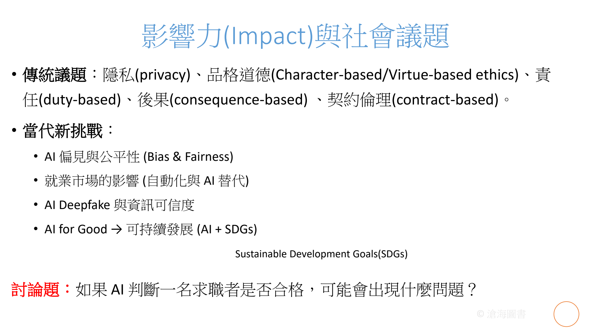

| 哲學倫理派別 | 代表哲學家 | 核心主張 | 資訊工程與 AI 應用情境審視 |
| :--- | :--- | :--- | :--- |
| **品格道德倫理<br/>(Virtue-based Ethics)** | 亞里斯多德 (Aristotle) | 著重行為者的**道德品格**與內在德行（如誠信、勇氣、公正、節制）。 | 開發者在撰寫演算法時，是否秉持誠實與良善初衷？面對灰色地帶時是否展現道德勇氣？ |
| **義務論倫理<br/>(Duty-based / Deontological)** | 康德 (Immanuel Kant) | 著重行為本身是否符合絕對的**道義責任與原則**，不因結果好壞而改變。 | 即使為了廣告獲利，也不得未經許可竊取使用者隱私；保護個資是工程師不可逾越的絕對責任。 |
| **後果論 / 效益主義<br/>(Consequence-based / Utilitarian)** | 邊沁 (Bentham)、密爾 (Mill) | 以行為產生的**最終結果與整體福祉最大化**作為評判善惡標準。 | 自駕車在面臨極端車禍時的道德抉擇（電車難題）；系統更新是否為絕大多數使用者帶來利益？ |
| **契約論倫理<br/>(Contract-based Ethics)** | 霍布斯 (Hobbes)、洛克 (Locke) | 著重社會成員間相互訂立的**規範、法律、條約與知情同意協議**。 | 軟體服務條款 (EULA)、GDPR 歐盟個資法遵從度、開源軟體授權協議 (GPL/MIT) 的忠實遵循。 |

---

## 9. 綜合實務案例：Google Maps 串聯九大主題

如何將九大抽象的主題落實於單一系統中？以全球數十億人日常使用的 Google Maps 為例：

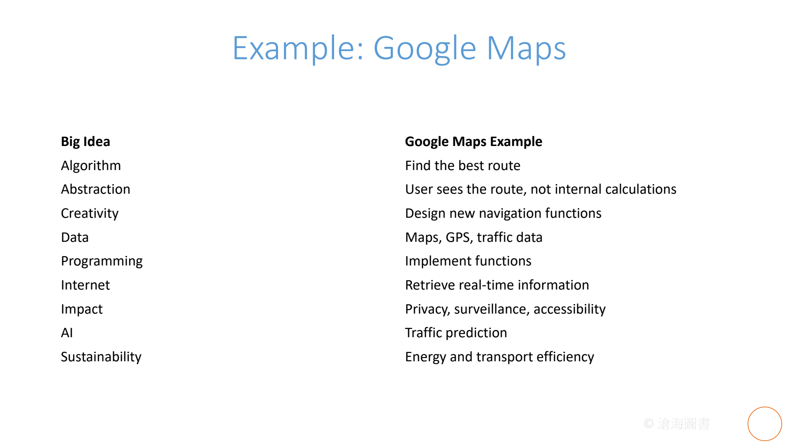

| 核心主題 (Big Idea) | Google Maps 實務運作機制 (System Implementation) |
| :--- | :--- |
| **1. 演算法 (Algorithms)** | 採用 Dijkstra、A* 搜尋演算法或階層式圖形分群演算法，在毫秒內尋找兩點間最短/最快路徑。 |
| **2. 抽象化 (Abstraction)** | 使用者在手機螢幕上只需看到一條藍色導航路線與轉彎提示，內部龐大的圖論矩陣計算被完全隱藏。 |
| **3. 創造性 (Creativity)** | 整合 Street View 街景實境、AR 實境抬頭引導、室內平面圖導航等創新功能。 |
| **4. 資料 (Data)** | 融合全球向量地圖圖層、高解析度衛星空拍圖、即時 GPS 座標、店家營業資訊大數據。 |
| **5. 程式化 (Programming)** | 透過跨平台高效能 C++、Java、Kotlin、Swift 與前端 WebAssembly 精確呈現地圖繪圖引擎。 |
| **6. 網際網路 (Internet)** | 透過全球邊緣節點 (CDN) 與高頻寬網路，即時串流龐大地圖圖塊 (Tiles) 與即時路況資訊。 |
| **7. 影響力 (Impact)** | 深刻改變全人類通勤習慣與物流外送經濟；伴隨引發行蹤隱私外洩、位置資料被監控等爭議。 |
| **8. 人工智慧 (AI & ML)** | 分析全球數億部 Android 設備的移動速率，使用機器學習模型精準預測未來 1 小時之交通擁塞程度。 |
| **9. 數位永續 (Sustainability)** | 推出「節能優先路徑 (Eco-friendly routing)」，引導駕駛避開頻繁煞車起步路段，顯著降低全球碳排放。 |

---

## 10. 專業術語中英對照表 (Bilingual Terminology Table)

| 英文術語 (English Term) | 繁體中文對照 (Traditional Chinese) | 詳細定義與專業意涵 (Definition & Context) |
| :--- | :--- | :--- |
| **Algorithm** | 演算法 | 為了解決特定問題所制訂之一組有順序性、無歧義且可執行的有限步驟。 |
| **Definiteness** | 確定性 / 明確性 | 演算法中每個運算步驟必須精確無歧義，輸入相同則產出必然相同。 |
| **Effectiveness** | 有效性 / 可行性 | 步驟必須足夠單純可行，理論上能在有限時間內以紙筆精準推演完畢。 |
| **Finiteness** | 有限性 / 終結性 | 演算法保證在執行有限個步驟後必須停機終結，不得陷入無窮死迴圈。 |
| **Euclidean Algorithm** | 歐幾里得輾轉相除法 | 藉由反覆將兩數相除取餘數，求取兩整數最大公因數的經典優雅演算法。 |
| **Abstraction** | 抽象化 | 隱藏內部實作細節，僅對外顯露關鍵操作介面以降低系統複雜度的核心思維。 |
| **Black Box** | 黑盒子 / 黑箱元件 | 僅知其輸入與輸出規格，內部運作結構被封裝隱藏的模組化元件。 |
| **Moore's Law** | 摩爾定律 | 積體電路上電晶體密度約每 18~24 個月翻倍，帶動算力指數型躍升的產業經驗法則。 |
| **Instruction Cycle** | 指令週期 | CPU 執行指令的四部曲：擷取 (Fetch)、解碼 (Decode)、執行 (Execute)、寫回 (Write-back)。 |
| **Agentic Coding** | 自主代理程式設計 | 具備自主環境感知、呼叫工具、自我反思與除錯的新一代 AI 程式開發典範。 |
| **Vibe Coding** | 直覺共感編程 | 開發者透過日常自然語言提示與直覺互動，由 AI 即時轉譯生成程式碼之新型開發體驗。 |
| **Deepfake** | 深度偽造技術 | 透過深度生成神經網路（如 GAN 或擴散模型）偽造以假亂真的人臉、聲音與影片。 |
| **Virtue-based Ethics** | 品格道德倫理 (德行論) | 亞里斯多德哲學主張，著重從事技術決策之個人內在品格、誠信與良善素養。 |
| **Duty-based Ethics** | 義務論倫理 | 康德哲學主張，強調遵守不可侵犯的客觀原則與道義義務（如絕對保護個資）。 |
| **Consequence-based Ethics** | 後果論倫理 (效益主義) | 以行為帶來之最終結果利害與最大多數人之福祉為道德評判依據。 |
| **Contract-based Ethics** | 契約論倫理 | 依據社會或組織成員間所共同簽署或認可之法規、契約與知情條款作為規範基礎。 |
