# Module 2: 演算法與問題解決全解析 (Algorithms & Problem Solving)

> **對應課本章節**：Chapter 5: Algorithms (Brookshear & Brylow, 13th Edition)  
> **核心目標**：深入掌握演算法之正式定義、表示法、Pólya 解題四階段、迭代與遞迴結構、搜尋與排序演算法、Big-O 複雜度分析、迴圈不變量與軟體驗證。

---

## 📑 目錄 (Table of Contents)
1. [演算法的正式定義與抽象本質 (Formal Definition & Abstraction)](#1-演算法的正式定義與抽象本質-formal-definition--abstraction)
2. [程序、演算法與程式之核心辨析 (Process vs Algorithm vs Program)](#2-程序演算法與程式之核心辨析-process-vs-algorithm-vs-program)
3. [演算法的表示法與語法基元 (Representation & Primitives)](#3-演算法的表示法與語法基元-representation--primitives)
4. [Pólya 解題四階段與啟發式策略 (Pólya's Problem Solving & Heuristics)](#4-pólya-解題四階段與啟發式策略-pólyas-problem-solving--heuristics)
5. [經典解題案例研討 (Case Studies)](#5-經典解題案例研討-case-studies)
   - 案例 1：小孩年齡猜測問題 (Children's Ages Problem)
   - 案例 2：賽跑名次邏輯預測 (Race Order Prediction)
   - 案例 3：正整數最大乘積拆解 (Largest Product Set Problem)
6. [迭代結構與搜尋排序演算法 (Iterative Structures, Search & Sort)](#6-迭代結構與搜尋排序演算法-iterative-structures-search--sort)
   - 迴圈控制三大要素 (Components of Repetitive Control)
   - 前測試迴圈 vs 後測試迴圈 (Pretest vs Posttest Loops)
   - 循序搜尋法 (Sequential Search)
   - 插入排序法 (Insertion Sort) 深度追蹤
   - 選擇排序法 (Selection Sort)
7. [遞迴結構與二元搜尋法 (Recursive Structures & Binary Search)](#7-遞迴結構與二元搜尋法-recursive-structures--binary-search)
   - 遞迴兩大支柱：基本情況與遞迴步驟 (Base Case & Recursive Step)
   - 呼叫堆疊與望遠鏡效應 (Call Stack & Telescoping Effect)
   - 遞迴 vs 迭代深度對比 (Recursion vs Iteration)
   - 二元搜尋法 (Binary Search: 迭代與遞迴實作)
8. [演算法效率與大 O 符號 (Efficiency, Complexity & Big-O Notation)](#8-演算法效率與大-o-符號-efficiency-complexity--big-o-notation)
   - 時間複雜度與空間複雜度
   - 大 O 多項式定理 (Polynomial Theorem)
   - 常見複雜度階層成長率排名
   - 經典啟發式案例：金環切割問題 (Chain Separating Problem)
9. [軟體驗證與迴圈不變量 (Software Verification & Loop Invariants)](#9-軟體驗證與迴圈不變量-software-verification--loop-invariants)
10. [專業術語中英對照表 (Bilingual Terminology Table)](#10-專業術語中英對照表-bilingual-terminology-table)

---

## 1. 演算法的正式定義與抽象本質 (Formal Definition & Abstraction)

在計算機科學中，演算法有嚴謹的數學與工程定義：

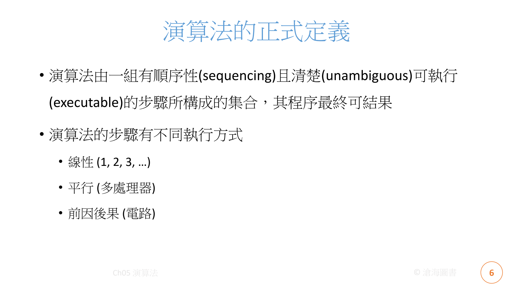

> ### 演算法的正式定義 (Formal Definition)
> **"An algorithm is an ordered set of unambiguous, executable steps that defines a terminating process."**  
> （演算法是由一組**具順序性 (Sequencing)**、**明確無歧義 (Unambiguous)** 且**可執行 (Executable)** 的步驟所構成的集合，其保證能定義出一個**最終會終結 (Terminating)** 的程序。）

### 四大關鍵要素拆解：
1. **順序性 (Sequencing / Ordered Set)**：
   - 步驟的執行次序受到嚴格限制。步驟 $A$ 必須在步驟 $B$ 之前完成，不能隨意顛倒。
2. **明確性 / 確定性 (Unambiguous)**：
   - 每個步驟的指示必須清晰明確，不可含糊籠統。執行者對於下一步該做什麼毫無疑慮。
3. **可執行性 (Executable)**：
   - 該步驟必須在執行實體（無論是人類還是微處理器）的能力範圍之內。
4. **終結性 (Terminating)**：
   - 程序必須在有限的時間和步驟後結束，不能演變為永不終止的死迴圈。

### 抽象本質：故事與書本的類比 (The Story vs Book Analogy)
演算法與它的表達形式之間具有強烈的**抽象層級差異**：
- **演算法 (Algorithm)** 本身是**抽象的思維概念**，如同一個「故事 (Story)」或「曲調 (Melody)」。
- **程式碼、虛擬碼或流程圖** 只是演算法的**具體表現載體**，如同印製故事的「實體書本 (Book)」或寫在五線譜上的「樂譜」。
- 即使書本燒毀或改用不同語言印製，故事的本質依然存在；同理，一個演算法無論是用 Python、C++ 實作，或繪製成流程圖，演算法本身的數學本質永不改變。

---

## 2. 程序、演算法與程式之核心辨析 (Process vs Algorithm vs Program)

初學者容易混淆這三個術語，請務必掌握其層次區別：

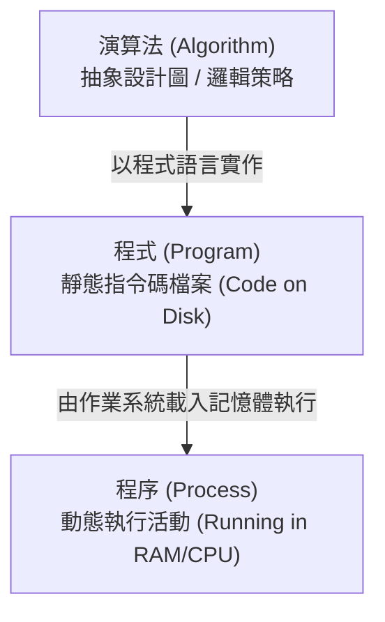

| 比較項目 | 演算法 (Algorithm) | 程式 (Program) | 程序 (Process) |
| :--- | :--- | :--- | :--- |
| **本質形態** | 抽象的概念、數學邏輯或步驟描述。 | 靜態的文字檔案 (Source Code / Binary)。 | 動態的執行實體 (Active Execution Activity)。 |
| **存在位置** | 人類大腦、紙本筆記、學術論文。 | 硬碟、GitHub 倉儲、ROM。 | 電腦主記憶體 (RAM) 與 CPU 暫存器中。 |
| **語言相依性** | 獨立於特定語言（可用虛擬碼、流程圖）。 | 嚴格受限於特定程式語言的語法規格。 | 相依於底層作業系統與硬體架構 (ABI)。 |
| **生命週期** | 永恆不變的理論模型。 | 保存於檔案系統中，直到被刪除或修改。 | 從載入啟動 (Start) 到結束終止 (Terminate)。 |

---

## 3. 演算法的表示法與語法基元 (Representation & Primitives)

任何複雜的演算法，皆是由最基礎且定義完善的**語法基元 (Primitives / 原式)** 組裝而成。

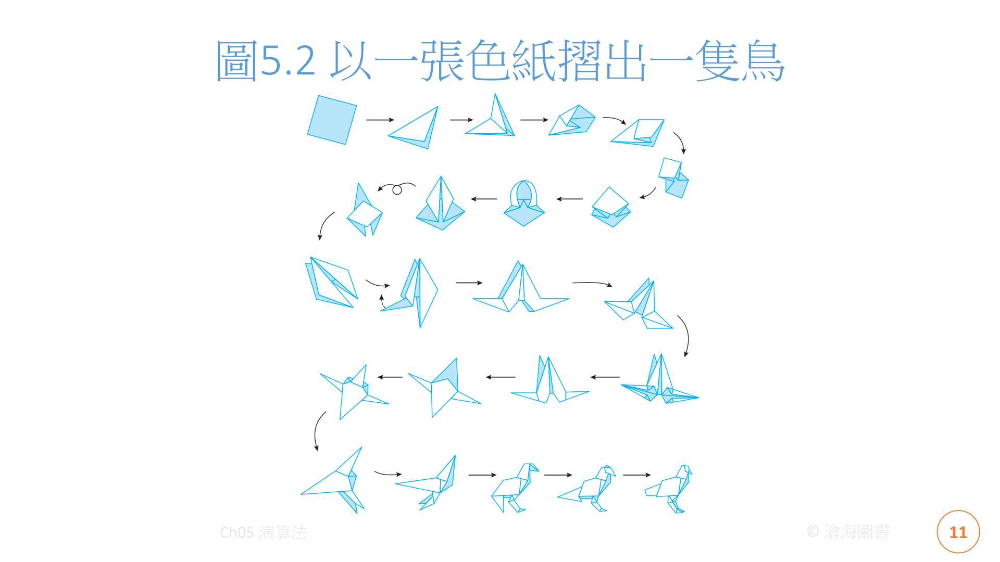
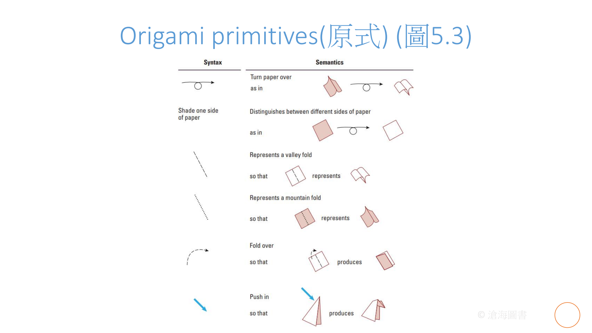

> **摺紙比喻 (Origami Analogy)**：  
> 一張色紙之所以能摺成一隻精巧的紙鶴，並非靠魔法，而是由一系列定義完善的「摺紙基元」（谷摺、山摺、翻面、拉角）按順序組合而成。程式語言亦然。

### 演算法三大基本控制結構 (The Three Fundamental Control Structures)
Böhm 與 Jacopini 證明的結構化定理指出，任何可計算問題皆僅需三種結構即可表達：
1. **順序結構 (Sequencing)**：由上而下循序執行。
2. **選擇結構 (Selection / Branching)**：根據條件真假分流 (`if-else`)。
3. **重複 / 迭代結構 (Iteration / Repetition)**：根據條件反覆執行 (`while / for`)。

### 虛擬碼語法原式 (Pseudocode Primitives)

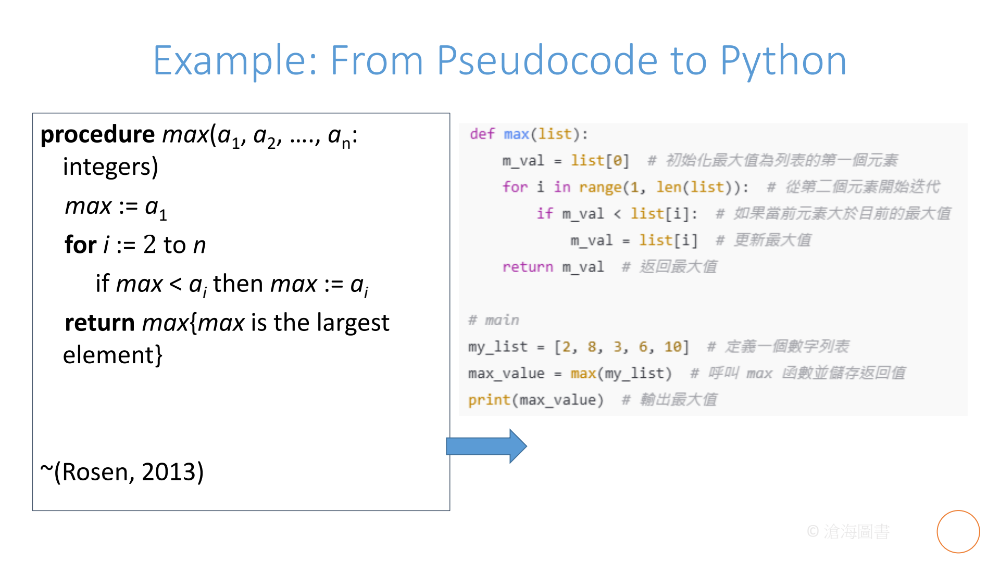

1. **指定陳述 (Assignment)**：
   - 將運算式的計算結果存入特定變數中：
     $$\text{name} \longleftarrow \text{expression} \quad \text{或} \quad \text{name} = \text{expression}$$
2. **條件式選擇 (Conditional Selection)**：
   ```text
   If (condition):
       activity_A
   Else:
       activity_B
   ```
3. **巢狀結構與縮排 (Nesting & Indentation)**：
   - 藉由層級縮排明確劃分作用範圍 (Scope)，避免多重條件分支產生二義性：
   ```text
   If (天氣良好):
       If (有球伴):
           去戶外打籃球
       Else:
           去操場跑步健身
   Else:
       在室內讀書寫程式
   ```
4. **反覆執行 (Repeated Execution)**：
   ```text
   While (condition):
       body_of_loop
   ```
5. **模組化函數與參數傳遞 (Functions & Parameters)**：
   - 封裝獨立子程序，透過參數 (Parameters) 傳遞資料並透過回傳值回饋結果。

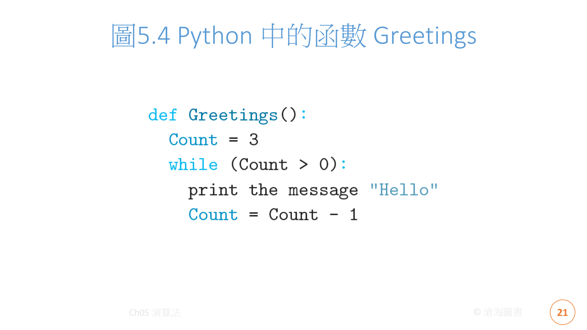

### 識別字命名慣例 (Naming Conventions)
- **PascalCase (大駝峰命名法)**：單字首字母皆大寫（如 `EstimatedArrivalTime`、`BinarySearchTree`），常用於類別名稱。
- **camelCase (小駝峰命名法)**：首個單字小寫，其後單字首字母大寫（如 `estimatedArrivalTime`），常用於 Java/JS 變數與方法。
- **snake_case (蛇形命名法)**：全小寫單字間以底線連接（如 `estimated_arrival_time`），常用於 Python 變數與函式。

---

## 4. Pólya 解題四階段與啟發式策略 (Pólya's Problem Solving & Heuristics)

著名數學家 George Pólya 於 1945 年在其巨作《如何解題》(How to Solve It) 中提出經典解題四步驟，至今仍是軟體工程與演算法設計的核心心法：

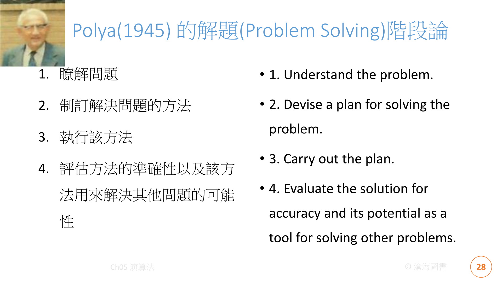

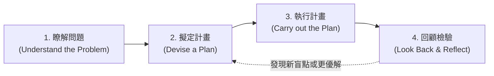

### 四階段精髓分析：
1. **瞭解問題 (Understand the Problem)**：
   - 未知數是什麼？已知資料是什麼？限制條件是什麼？條件是否充足？是否存在矛盾？
2. **擬定計畫 (Devise a Plan)**：
   - 過去是否見過類似問題？能否利用已知定理或解法？若無法直接解答，能否先解一個較簡單的相關問題？
3. **執行計畫 (Carry out the Plan)**：
   - 將計畫逐步轉化為虛擬碼與程式碼，仔細檢驗每一個運算步驟是否正確。
4. **回顧反思 (Look Back)**：
   - 能否檢驗結果？能否用另一種方法推導？該解法能否推廣應用於其他更廣泛的問題？

### 邁出第一步的啟發式法寶 (Getting a Foot in the Door)
- **反推法 (Working Backwards)**：從期望的最終目標狀態往回推算初始條件。
- **簡化子問題 (Solve a Simpler Related Problem)**：先將大數縮小（例如 $N=1000$ 先看 $N=3$ 的規律）。
- **列舉與過濾 (Stepwise Elimination)**：窮舉所有可能情況，逐一利用已知約束條件排除不合邏輯的組合。

---

## 5. 經典解題案例研討 (Case Studies)

### 案例 1：小孩年齡猜測問題 (Children's Ages Problem)

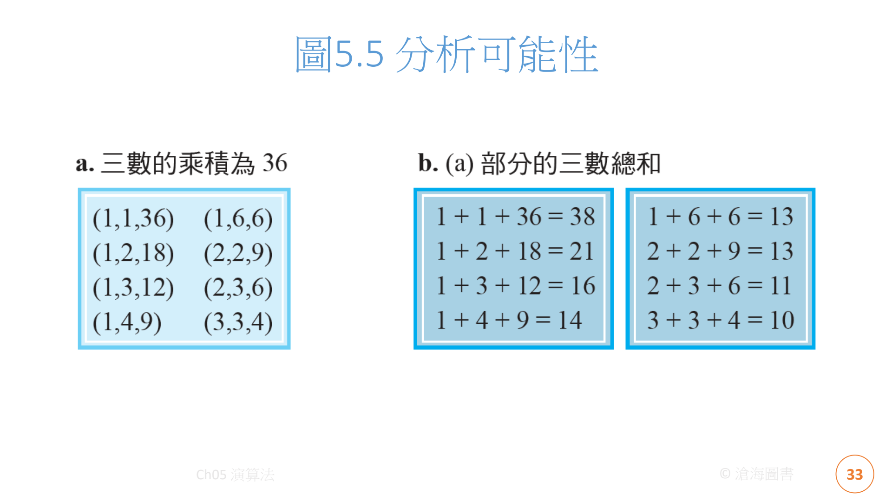

#### 問題情境：
甲請教乙的三個小孩年齡：
1. 乙提示：「三個小孩年齡相乘等於 36。」
2. 甲說：「線索不夠。」乙再提示：「三個小孩年齡相加剛好等於你看到的對面那棟房子的門牌號碼。」
3. 甲抬頭看門牌，思考片刻說：「線索還是不夠。」
4. 乙笑著說：「抱歉，我忘記告訴你，我最大的小孩正在樓上睡覺。」
5. 甲立刻回答：「我知道他們的年齡了！」請問三個小孩年齡分別是多少？

#### 啟發式解題推導：
- **步驟 1：列舉乘積為 36 的所有三個正整數組合及其總和**：
  | 年齡組合 $(a, b, c)$ | 乘積 | 總和 (門牌號碼) |
  | :--- | :---: | :---: |
  | $1, 1, 36$ | 36 | 38 |
  | $1, 2, 18$ | 36 | 21 |
  | $1, 3, 12$ | 36 | 16 |
  | $1, 4, 9$ | 36 | 14 |
  | **$1, 6, 6$** | **36** | **13** |
  | **$2, 2, 9$** | **36** | **13** |
  | $2, 3, 6$ | 36 | 11 |
  | $3, 3, 4$ | 36 | 10 |
- **步驟 2：邏輯剖析「線索還是不夠」**：
  - 甲已經看見了門牌號碼，如果總和是唯一的（如 38, 21, 16, 14, 11, 10），甲必定立刻破案。
  - 甲說「線索還是不夠」，證明門牌號碼必定出現重複！表中唯獨 **總和 13** 出現兩組可能性：$(1, 6, 6)$ 與 $(2, 2, 9)$。
- **步驟 3：剖析「最大的小孩」**：
  - 若是 $(1, 6, 6)$，有兩個 6 歲的雙胞胎老大，不存在「單一最大的小孩」。
  - 唯有 **$(2, 2, 9)$** 擁有單一最大的 9 歲孩子！
- **結論**：三個小孩年齡分別為 **2 歲、2 歲、9 歲**。

---

### 案例 2：賽跑名次邏輯預測 (Race Order Prediction)
A, B, C, D 四人賽跑前分別做出預測：
1. A 預測：B 會贏 (第 1 名)。
2. B 預測：C 會得第 2 名。
3. C 預測：D 會得第 3 名。
4. D 預測：A 預測錯了。
已知只有**獲得第 1 名的人**說了真話，其餘三人皆說假話。請問誰獲得了冠軍？
- **推理**：若 A 是第 1 名，A 說真話，則 B 贏，產生矛盾。若 B 是第 1 名，B 說真話，則 C 是第 2 名，但這時 A 說假話表示 B 沒贏，又矛盾。依此反推，唯有 **D 是第 1 名**，D 說真話（A 預測錯了確實為真），推導出一致結論！

---

### 案例 3：正整數最大乘積拆解 (Largest Product Set Problem)
- **問題**：給定一個正整數 $n$，將其拆分為若干個正整數的和：$n = a_1 + a_2 + \dots + a_k$，求乘積 $P = a_1 \times a_2 \times \dots \times a_k$ 的最大可能值。
- **數學原理分析**：
  - 對於任何 $x \ge 5$，我們都可以拆成 $2 \times (x-2) > x$ 或 $3 \times (x-3) > x$。因此因子不能大於 4。
  - 因子 4 可以看成 $2 \times 2$。
  - 比較拆成 2 與拆成 3：因為 $3^2 > 2^3$（即 $9 > 8$，每 6 的和，拆成 $3 \times 3 = 9$ 勝過 $2 \times 2 \times 2 = 8$），故應**盡可能多拆成 3**。
  - 特殊邊界：若最後餘數為 1（例如剩餘和為 4），切勿拆成 $3 + 1$，而應保留為 $2 + 2$（乘積 $4 > 3$）。
- 本專案實作程式碼請參見 [`code_examples/largest_product_set.py`](file:///c:/Nono/Intro.%20to%20Info.%20Eng/code_examples/largest_product_set.py)。

---

## 6. 迭代結構與搜尋排序演算法 (Iterative Structures, Search & Sort)

### 迴圈控制三大要素 (Components of Repetitive Control)

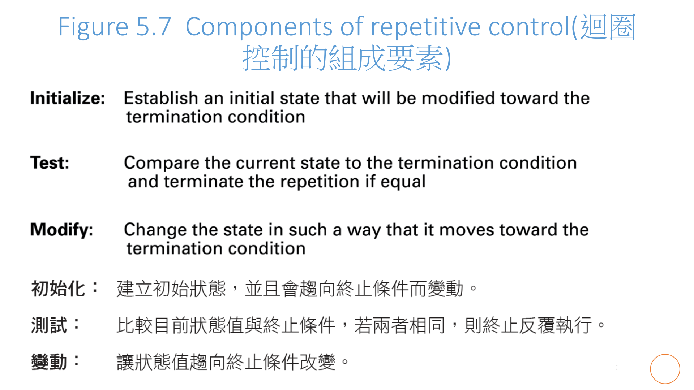

任何正確運行的迴圈結構，必須包含三個不可或缺的環節：
1. **初始化 (Initialization)**：設定迴圈控制變數的起始狀態。
2. **測試條件 (Test / Termination Condition)**：判斷迴圈是否該繼續執行。
3. **狀態變更 (Modification / Update)**：在每次迭代中推進控制變數，確保程式朝終止條件靠攏。  
> ⚠️ **若遺漏 Modification，迴圈條件將永遠維持真值，導致系統陷入無窮迴圈 (Infinite Loop) 崩潰！**

### 前測試迴圈 vs 後測試迴圈 (Pretest vs Posttest Loops)
- **前測試迴圈 (Pretest Loop / While)**：在進入迴圈主體**之前**先進行條件檢驗。若初始條件為假，迴圈主體**可能執行 0 次**。
- **後測試迴圈 (Posttest Loop / Do-While / Repeat-Until)**：先執行一次迴圈主體，在**末端**才檢驗條件。保證主體**至少執行 1 次**。

---

### 循序搜尋法 (Sequential / Linear Search)

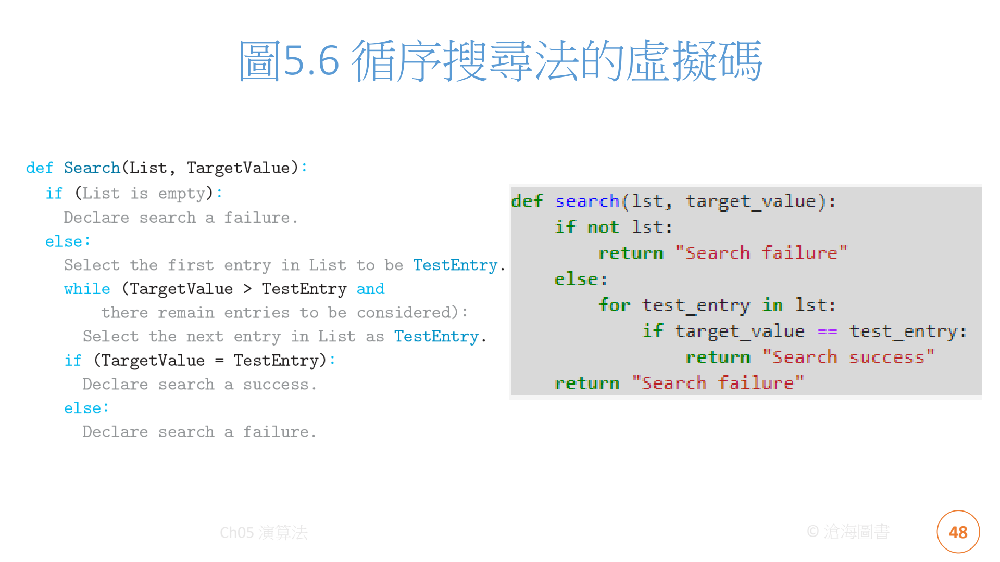

- **核心概念**：從陣列的第一個元素開始，依序將每個元素與目標比對，直到找到相符者或走訪完整個清單。
- **複雜度**：
  - 最佳情況 (Best Case)：目標位於第 1 個位置 $\implies O(1)$。
  - 最壞情況 (Worst Case)：目標位於最後 1 個位置或不存在 $\implies O(n)$。
  - 平均情況 (Average Case)：比對約 $n/2$ 次 $\implies O(n)$。
- 程式實作請見 [`code_examples/sequential_search.py`](file:///c:/Nono/Intro.%20to%20Info.%20Eng/code_examples/sequential_search.py)。

---

### 插入排序法 (Insertion Sort) 深度追蹤

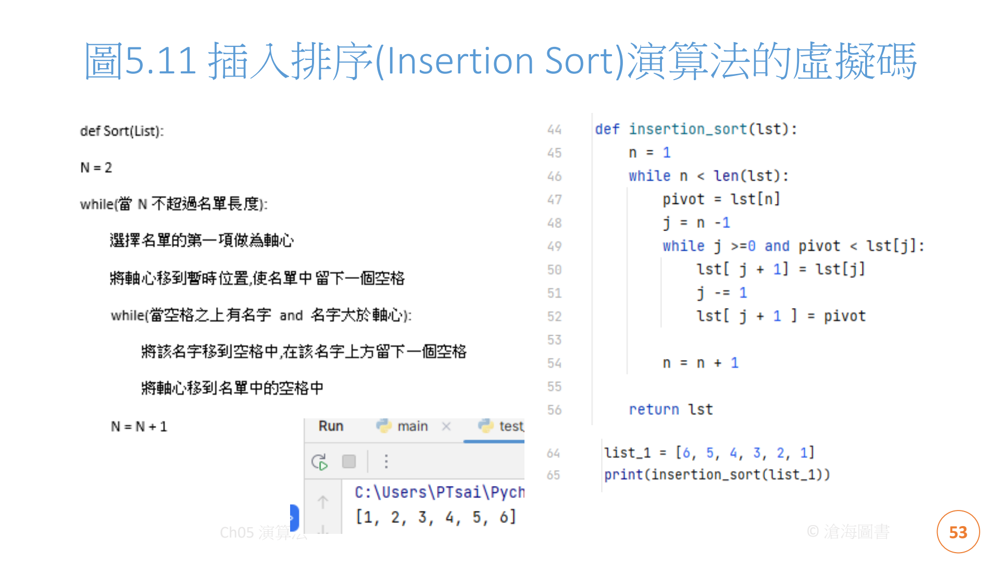
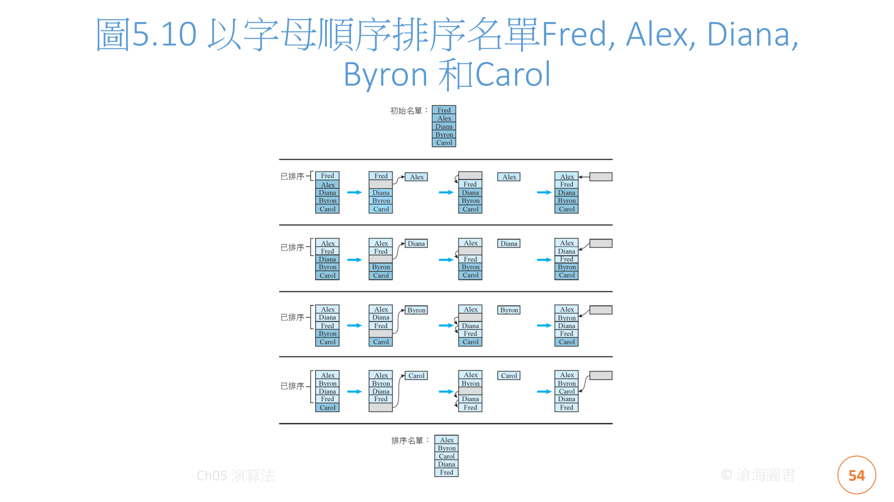

- **核心生活比喻**：如同玩撲克牌摸牌時整理手牌。手牌始終保持有序，每摸一張新牌，便從右往左比較，將大於新牌的牌往右挪移，直到找到合適縫隙插入。
- **教材範例追蹤**：排序清單 `[Fred, Alex, Diana, Byron, Carol]`
  1. 初始已排序區：`[Fred]`；待插入：`Alex`。
     - $Fred > Alex \implies$ Fred 右移，Alex 插入首位 $\implies$ `[Alex, Fred, Diana, Byron, Carol]`
  2. 已排序區：`[Alex, Fred]`；待插入：`Diana`。
     - $Fred > Diana$ (Fred 右移)，$Alex \le Diana \implies$ Diana 插入 Fred 原位 $\implies$ `[Alex, Diana, Fred, Byron, Carol]`
  3. 已排序區：`[Alex, Diana, Fred]`；待插入：`Byron`。
     - Fred, Diana 右移，插入在 Alex 之後 $\implies$ `[Alex, Byron, Diana, Fred, Carol]`
  4. 已排序區：`[Alex, Byron, Diana, Fred]`；待插入：`Carol`。
     - Fred, Diana 右移，插入在 Byron 之後 $\implies$ `[Alex, Byron, Carol, Diana, Fred]`
  - 完成排序！
- **最壞情況分析**：清單完全逆序排，第 $i$ 回合需比較 $i$ 次，總比較次數：
  $$1 + 2 + 3 + \dots + (n-1) = \frac{n(n-1)}{2} = \frac{1}{2}n^2 - \frac{1}{2}n \implies \mathbf{O(n^2)}$$

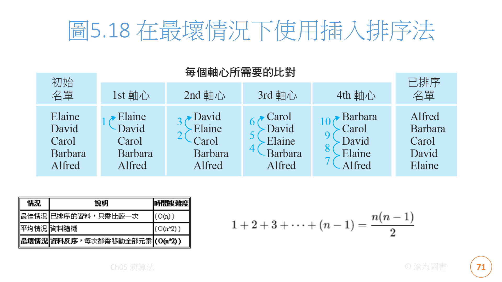
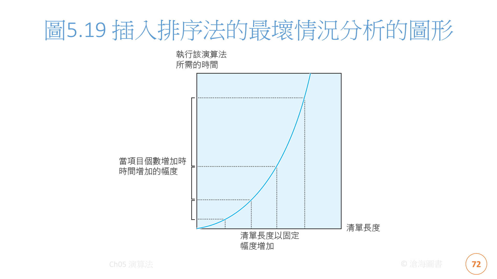

---

### 選擇排序法 (Selection Sort)
- **核心概念**：每次走訪尚未排序的子區間，挑選出全局最小值 (Minimum)，並將其與未排序區間的第一個元素交換位置。
- **特性**：不論原始數列排序狀況如何，永遠需要進行 $n(n-1)/2$ 次比對，時間複雜度恆為 $O(n^2)$。實作見 [`code_examples/selection_sort.py`](file:///c:/Nono/Intro.%20to%20Info.%20Eng/code_examples/selection_sort.py)。

---

## 7. 遞迴結構與二元搜尋法 (Recursive Structures & Binary Search)

### 遞迴的本質 (Nature of Recursion)
> **遞迴 (Recursion)** 是一種「一個程序在執行過程中直接或間接呼叫自身」的程式結構。

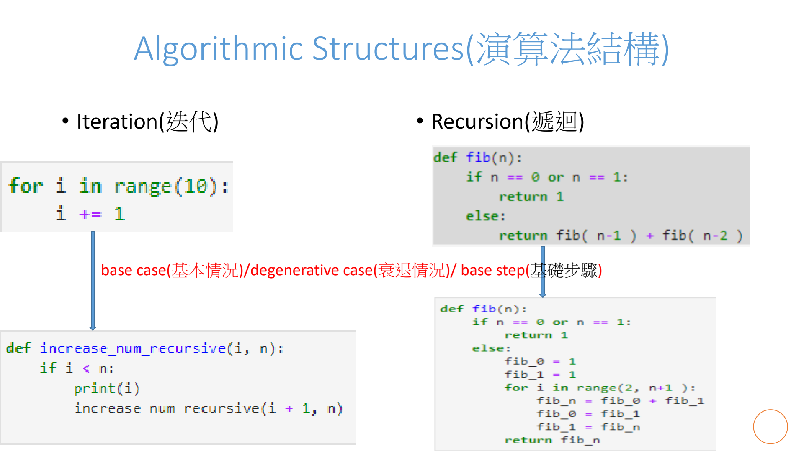

#### 遞迴的兩大支柱：
1. **基本情況 (Base Case / Degenerative Case)**：
   - 遞迴的終止點。此時問題已簡化至極限，可直接得出解答而無需進一步呼叫自身。
2. **遞迴步驟 (Recursive Step)**：
   - 將原問題轉化為結構完全相同、但**規模更小**的子問題來呼叫自身。

### 呼叫堆疊與望遠鏡展開/收縮效應 (Call Stack & Telescoping Effect)
遞迴呼叫時，系統會在記憶體堆疊 (Call Stack) 中為每一次呼叫建立獨立的堆疊訊框 (Stack Frame)。這如同望遠鏡逐節抽拉展開，直到撞擊 Base Case 後，才從最內層將結果逐層回傳計算並收縮折疊。

```mermaid
graph TD
    subgraph 展開階段 (Telescoping Expand)
        F4["Factorial(4) = 4 * Factorial(3)"] --> F3["Factorial(3) = 3 * Factorial(2)"]
        F3 --> F2["Factorial(2) = 2 * Factorial(1)"]
        F2 --> F1["Factorial(1) -> 觸發 Base Case 回傳 1"]
    end
    subgraph 回推收縮階段 (Telescoping Collapse)
        F1 -->|回傳 1| R2["Factorial(2) = 2 * 1 = 2"]
        R2 -->|回傳 2| R3["Factorial(3) = 3 * 2 = 6"]
        R3 -->|回傳 6| R4["Factorial(4) = 4 * 6 = 24"]
    end
```

### 遞迴 vs 迭代深度對比表 (Recursion vs Iteration)

| 比較維度 | 迭代 (Iteration) | 遞迴 (Recursion) |
| :--- | :--- | :--- |
| **控制方式** | 利用重複控制結構 (`while`, `for`)。 | 利用函數重複自我呼叫 (Self-calling)。 |
| **終止判斷** | 迴圈測試條件變為假時跳出。 | 抵達基本情況 (Base Case) 時觸發回傳。 |
| **記憶體負擔** | 極低，通常僅需固定數量的區域變數 $\implies O(1)$ 額外空間。 | 較高，每一層遞迴均需佔用 Call Stack $\implies O(\text{depth})$ 空間。 |
| **崩潰風險** | 無窮迴圈時 CPU 滿載卡死。 | 無窮遞迴時迅速耗盡堆疊記憶體，拋出 **Stack Overflow**。 |
| **程式可讀性** | 對複雜分治題（如樹狀遍歷、漢諾塔）邏輯較繁瑣。 | 數學形式優雅、代碼精簡，極度契合分治與樹狀演算法。 |

---

### 二元搜尋法 (Binary Search)

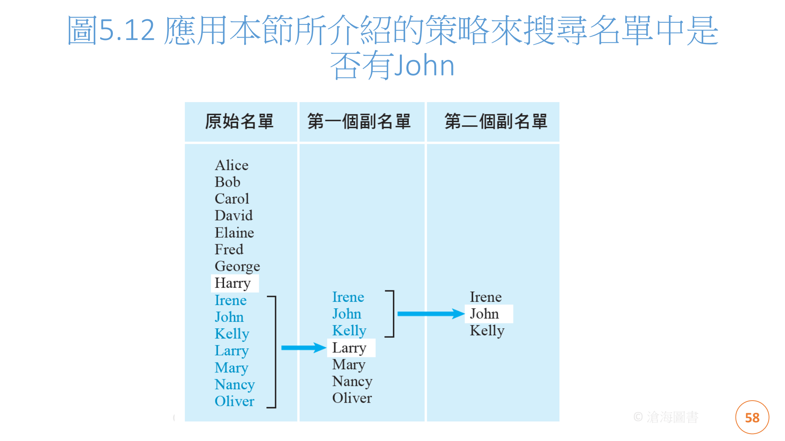
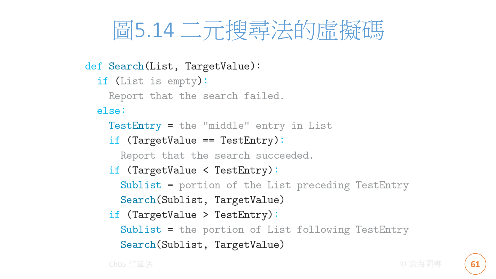

- **前提條件**：數列**必須已經完成排序**。
- **演算法策略 (Divide and Conquer)**：
  1. 找出當前搜尋區間的正中間元素 (Midpoint)。
  2. 若 `target == Midpoint`，命中目標！
  3. 若 `target < Midpoint`，表示目標必定在左半區間，排除右半邊所有元素。
  4. 若 `target > Midpoint`，表示目標必定在右半區間，排除左半邊所有元素。
  5. 每次比較皆將候選範圍縮小一半！

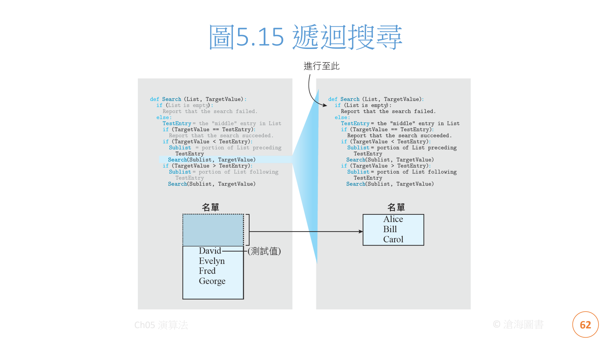
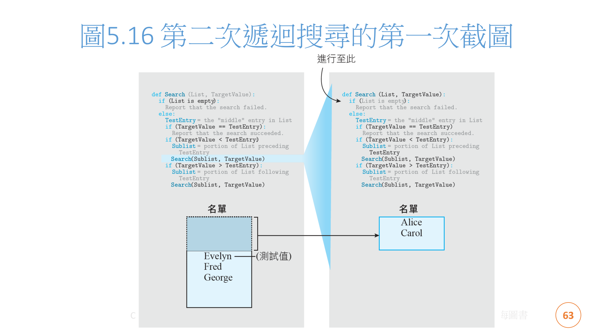
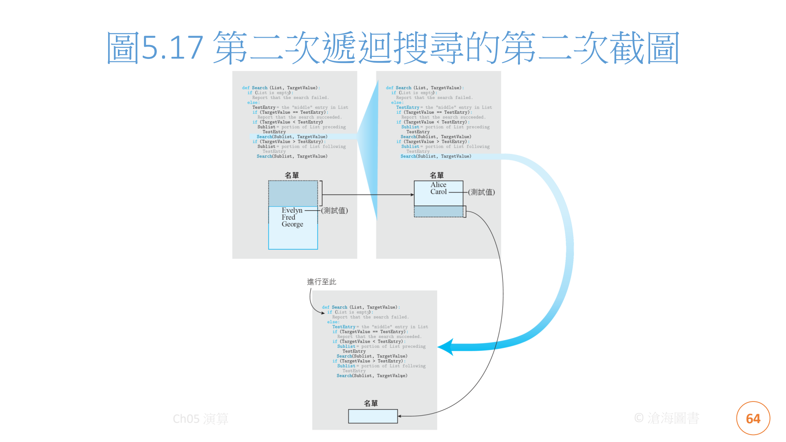

#### 效率震撼對比：
對於大小為 $N$ 的已排序清單，二元搜尋法最壞情況下的比較次數為：
$$K = \lceil \log_2(N) \rceil$$
- **若清單有 200 筆資料**：最多只需比較 $\lceil \log_2(200) \rceil = \mathbf{8}$ 次！
- **若清單有 10 萬筆資料**：最多只需比較 $\lceil \log_2(100,000) \rceil = \mathbf{17}$ 次！
- **若清單有 40 億筆資料 (全球人口規模)**：最多僅需約 **32 次** 比對即可定位！

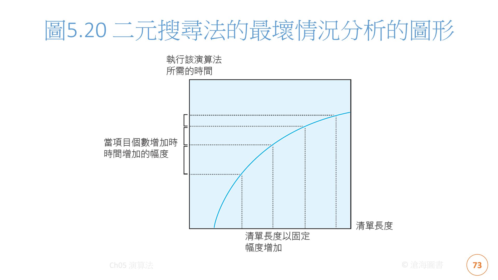

- 實作請見 [`code_examples/binary_search_iterative.py`](file:///c:/Nono/Intro.%20to%20Info.%20Eng/code_examples/binary_search_iterative.py) 與 [`code_examples/binary_search_recursive.py`](file:///c:/Nono/Intro.%20to%20Info.%20Eng/code_examples/binary_search_recursive.py)。

---

## 8. 演算法效率與大 O 符號 (Efficiency, Complexity & Big-O Notation)

演算法的優劣無法透過「用碼表計時」來客觀衡量，因為電腦硬體規格、作業系統排程皆會造成干擾。因此計算機科學採用**漸進行為分析 (Asymptotic Analysis)**。

### 大 O 多項式定理 (Polynomial Theorem for Big-O)

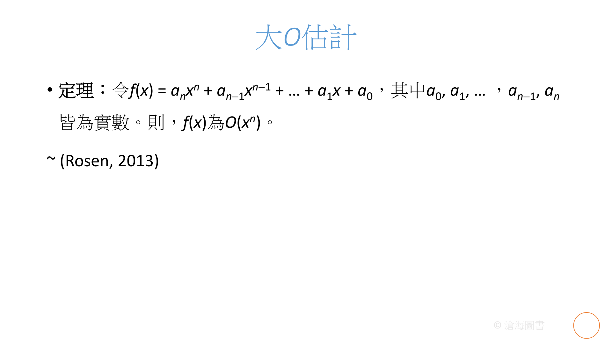

> **定理**：令多項式 $f(n) = a_k n^k + a_{k-1} n^{k-1} + \dots + a_1 n + a_0$，其中最高次項係數 $a_k \ne 0$。  
> 則當 $n \to \infty$ 時：
> $$f(n) = O(n^k)$$

**簡化兩大黃金準則**：
1. **忽略低次項**：當 $n$ 趨近於無限大時，低次項的增長量微不足道（例如 $3n^3 + 2n^2 + 5n \implies 3n^3$）。
2. **忽略最高次項的常數係數**：常數倍率不改變其漸進成長趨勢（例如 $3n^3 \implies O(n^3)$）。

### 常見時間複雜度階層成長率排名

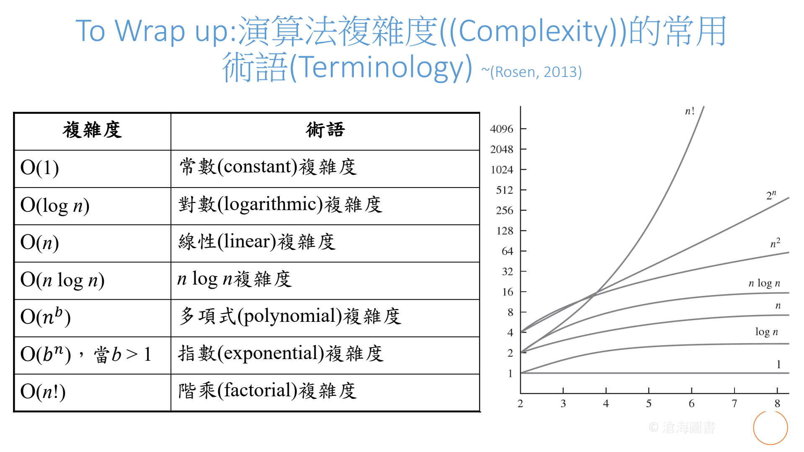
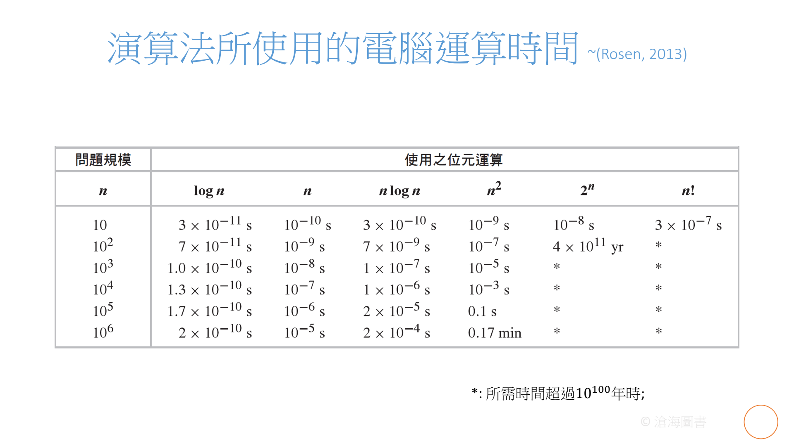

$$\mathbf{O(1)} < \mathbf{O(\log n)} < \mathbf{O(n)} < \mathbf{O(n \log n)} < \mathbf{O(n^2)} < \mathbf{O(2^n)} < \mathbf{O(n!)}$$

| 大 O 符號 | 專有名詞 (Name) | 典型演算法代表 (Examples) | $n=1,000$ 運算規模 |
| :---: | :--- | :--- | :--- |
| **$O(1)$** | 常數時間 (Constant Time) | 陣列索引存取、哈希表查找 | $1$ 步 |
| **$O(\log n)$** | 對數時間 (Logarithmic Time) | 二元搜尋法 (Binary Search) | 約 $10$ 步 |
| **$O(n)$** | 線性時間 (Linear Time) | 循序搜尋法 (Sequential Search)、單層走訪 | $1,000$ 步 |
| **$O(n \log n)$** | 線性對數時間 (Linearithmic) | 合併排序 (Merge Sort)、快速排序平均 (Quick Sort) | 約 $10,000$ 步 |
| **$O(n^2)$** | 平方時間 (Quadratic Time) | 插入排序 (Insertion Sort)、選擇排序、氣泡排序 | $1,000,000$ 步 |
| **$O(2^n)$** | 指數時間 (Exponential Time) | 暴力破解密碼、河內塔問題 | $10^{301}$ 步 (宇宙毀滅前算不完) |
| **$O(n!)$** | 階乘時間 (Factorial Time) | 旅行推銷員暴力全排列 (Traveling Salesperson) | 天文數字 (不可行) |

---

### 經典啟發式案例：金環切割問題 (Chain Separating Problem)

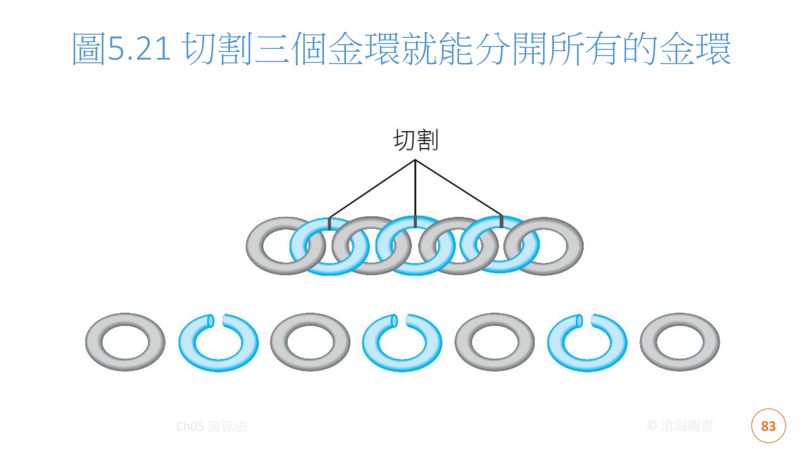
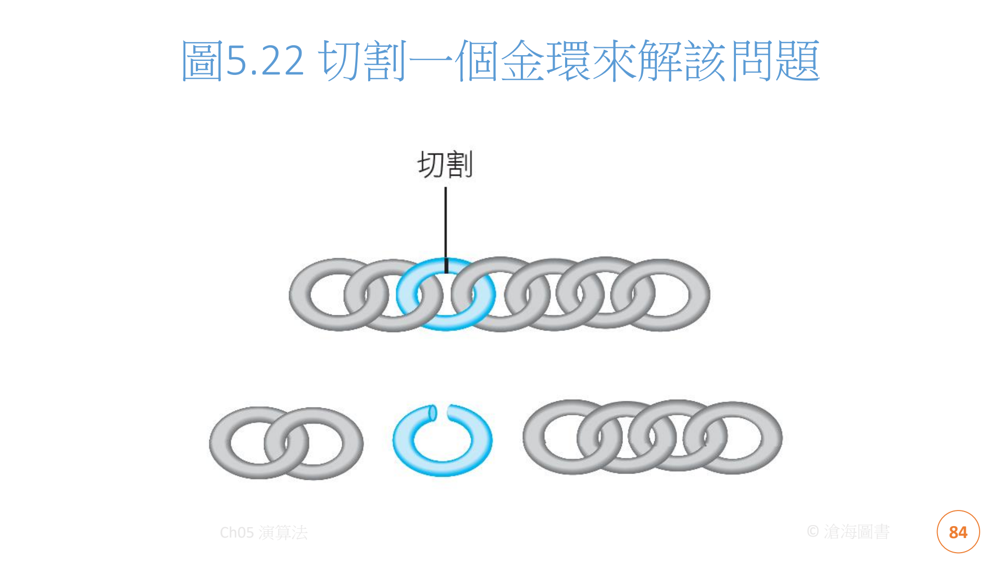

#### 題目背景：
一位旅者帶著一條由 7 個相互連接的金環組成的項鍊投宿旅店。旅店規定房費每天須支付 1 個金環，入住結束剛好 7 天。每天旅者必須精確支付 cumulative 總額（旅店老闆可以找零金環給旅者）。旅者希望切割最少數量的金環來完成這 7 天的精確支付。

#### 思考與演算法突破：
- **直覺盲點解法**：切斷第 2、4、6 環，共切 3 個環，得到 3 個單環與 2 條雙環鍊（切 3 刀）。
- **最優二進制演算法 (Binary Power Representation)**：
  - 只要**僅切斷第 3 個環**（只切 1 刀！），我們將得到：
    1. 1 個獨立單環 ($2^0 = 1$)
    2. 1 條長度為 2 的環鍊 ($2^1 = 2$)
    3. 1 條長度為 4 的環鍊 ($2^2 = 4$)
  - 利用 $1, 2, 4$ 組合，相當於**二進位編碼 ($2^0, 2^1, 2^2$)**，能精確湊出 $1 \sim 7$ 的任何整數：
    - Day 1: 給予 1 環。
    - Day 2: 給予 2 環鍊，找回 1 環（旅店手頭有 2 環）。
    - Day 3: 再給予 1 環（旅店手頭有 $2+1=3$ 環）。
    - Day 4: 給予 4 環鍊，找回 1 環和 2 環鍊（旅店手頭有 4 環）。
    - Day 5: 再給予 1 環（旅店手頭有 $4+1=5$ 環）。
    - Day 6: 給予 2 環鍊，找回 1 環（旅店手頭有 $4+2=6$ 環）。
    - Day 7: 給予最後的 1 環（旅店手頭擁有完整 7 環）。
  - **啟示**：演算法的威力在於透過數學規律（二進位權重）將複雜操作壓縮至極限！

---

## 9. 軟體驗證與迴圈不變量 (Software Verification & Loop Invariants)

我們如何確信自己寫出的演算法在任何情境下都絕對正確？現代軟體工程依賴**形式化邏輯驗證 (Formal Logic Verification)**：

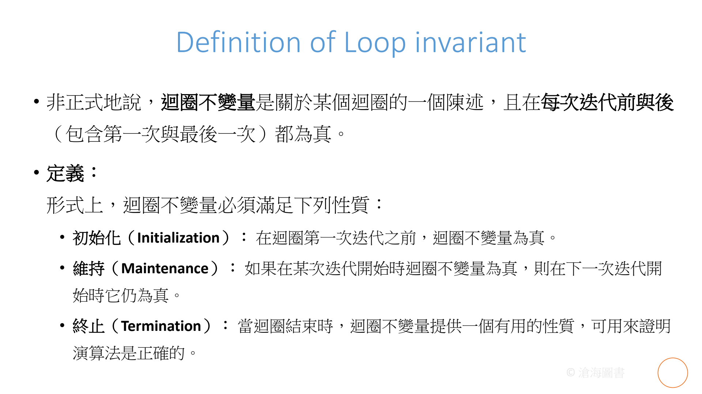
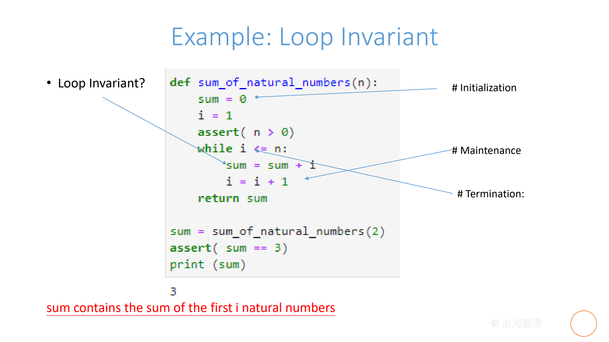

### 關鍵概念：
- **前置條件 (Precondition)**：演算法執行前，輸入資料必須滿足的先決狀態限制。
- **斷言 (Assertion)**：在程式特定執行點，邏輯上恆為真 (True) 的布林表達式陳述。
- **後置條件 (Postcondition)**：演算法執行結束後，系統與輸出資料所必然保證達成的狀態。

### 迴圈不變量 (Loop Invariant) 的三大檢驗原則
> **定義**：迴圈不變量是關於迴圈狀態的一項斷言陳述，在每一次迴圈迭代開始前以及結束後，該陳述**恆為真 (True)**。

證明演算法正確性的數學歸納法三部曲：
1. **初始性 (Initialization)**：
   - 在迴圈第 1 次迭代開始前，該不變量必須成立為真。
2. **保持性 (Maintenance)**：
   - 假設在第 $k$ 次迭代開始前該陳述為真，那麼在執行完第 $k$ 次迭代後，在進入第 $k+1$ 次迭代前，該陳述依然必須保持為真。
3. **終結性 (Termination)**：
   - 當迴圈終止時，迴圈不變量所保留的真值性質，配合迴圈終止條件，恰好能推導證明演算法確實達到了預期的最終解答！

- 本專案實作程式碼請參見 [`code_examples/loop_invariant_demo.py`](file:///c:/Nono/Intro.%20to%20Info.%20Eng/code_examples/loop_invariant_demo.py)。

---

## 10. 專業術語中英對照表 (Bilingual Terminology Table)

| 英文術語 (English Term) | 繁體中文對照 (Traditional Chinese) | 詳細定義與專業意涵 (Definition & Context) |
| :--- | :--- | :--- |
| **Sequencing** | 順序性 | 演算法中指令按嚴格的邏輯先後次序由上而下依序執行的基本特徵。 |
| **Unambiguous** | 明確性 / 無二義性 | 指令語意具備單一且清晰的解讀方式，不允許產生任何歧義。 |
| **Executable** | 可行性 / 可執行的 | 指令能在有限時間內被具體硬體或運算者精確執行完畢。 |
| **Termination** | 終結性 / 停機保證 | 演算法對於合法輸入必須保證在有限步驟內終止，不陷入無窮死迴圈。 |
| **Primitive** | 原式 / 語法基元 | 構成演算法或程式語言的最基礎、無可分割且定義完善之指令積木。 |
| **Pseudocode** | 虛擬碼 | 介於自然語言與正式程式碼之間的演算法描述工具，著重邏輯傳達而免去語法瑣碎限制。 |
| **Indentation** | 縮排 | 程式原始碼中行首的空格縮排，用以清晰界定巢狀區塊 (Scope) 的語法結構。 |
| **Assignment** | 指定陳述 | 將右側運算式的計算數值賦予並儲存於左側變數記憶體位置的運算。 |
| **Heuristics** | 啟發式解題策略 | 基於經驗法則、簡化模型或直覺推論，用以加速尋找問題滿意解的方法論。 |
| **Iterative Structure** | 迭代結構 | 透過迴圈 (`while`、`for`) 機制重複執行特定指令序列的程式控制結構。 |
| **Recursive Structure** | 遞迴結構 | 程序藉由在自身內部呼叫自身，將問題逐步拆解為規模較小的同構子問題之結構。 |
| **Base Case** | 基本情況 / 退化條件 | 遞迴演算法中終止遞迴呼叫的底線條件，避免發生呼叫堆疊溢位 (Stack Overflow)。 |
| **Call Stack** | 呼叫堆疊 | 執行期間作業系統於記憶體中用以記錄函數呼叫階層、回傳位址與區域變數的先進後出結構。 |
| **Telescoping Effect** | 望遠鏡展開/收縮效應 | 遞迴呼叫時堆疊層層抽拉展開，碰觸基本情況後再層層收縮回傳數值的生動比喻。 |
| **Sequential Search** | 循序搜尋法 | 從頭到尾依序逐一比對陣列中每個元素的搜尋法，時間複雜度為 $O(n)$。 |
| **Binary Search** | 二元搜尋法 | 在已排序陣列中，透過中間值將搜尋範圍每次減半的高效搜尋法，複雜度為 $O(\log n)$。 |
| **Insertion Sort** | 插入排序法 | 模擬整理撲克牌手牌，逐一將未排序元素插入已排序序列正確縫隙的排序法 ($O(n^2)$)。 |
| **Selection Sort** | 選擇排序法 | 每次從未排序區間挑選全局極值與第一個元素對調的排序法 ($O(n^2)$)。 |
| **Big-O Notation** | 大 O 符號 | 用於數學描述當輸入規模 $n$ 趨近於無限大時，演算法資源耗費成長率之漸進上界。 |
| **Polynomial Theorem** | 多項式定理 | 大 O 分析中只保留最高次方項並忽略所有常數倍數與低次方項的簡化法則。 |
| **Loop Invariant** | 迴圈不變量 | 在每次迴圈迭代前後恆保持為真的邏輯斷言，用於數學形式化證明演算法之正確性。 |
| **Assertion** | 斷言 | 程式碼中於特定執行點嵌入的真值檢驗，若條件為假則立即中斷報錯以防軟體失控。 |
| **Precondition** | 前置條件 | 呼叫函數或執行演算法前，輸入資料必須滿足之先決約束條件。 |
| **Postcondition** | 後置條件 | 演算法成功執行完畢後，所保證產生之狀態輸出或正確性結果。 |
