# Module 3: 程式語言與設計典範全解析 (Programming Languages & Paradigms)

> **對應課本章節**：Chapter 6: Programming Languages (Brookshear & Brylow, 13th Edition)  
> **核心目標**：全面掌握程式語言的演進世代、四大程式設計典範（命令式、物件導向、函數式、宣告式）、資料型別與結構（二維陣列 Row-major 定址推導與結構體）、控制結構、程序單元與參數傳遞（傳值 vs 傳址），以及物件導向三大核心特性（封裝、繼承、多型）。

---

## 📑 目錄 (Table of Contents)
1. [程式語言的演進歷史與抽象世代 (Historical Perspective & Generations)](#1-程式語言的演進歷史與抽象世代-historical-perspective--generations)
   - 第一世代：機器語言 (Machine Language)
   - 第二世代：組合語言與記憶術 (Assembly Language & Mnemonics)
   - 第三世代：與機器無關之高階語言 (Machine-Independent High-Level Languages)
   - 第四與第五世代：宣告式與問題解決語言 (Declarative & Natural Languages)
2. [四大程式設計典範 (Programming Paradigms)](#2-四大程式設計典範-programming-paradigms)
   - 命令式 / 程序式典範 (Imperative / Procedural Paradigm)
   - 物件導向典範 (Object-Oriented Paradigm)
   - 函數式典範 (Functional Paradigm)
   - 宣告式典範 (Declarative Paradigm)
3. [傳統命令式程式設計核心概念 (Traditional Programming Concepts)](#3-傳統命令式程式設計核心概念-traditional-programming-concepts)
   - 基本資料型別 (Data Types: int, float, char, boolean)
   - 變數 (Variables) 與記憶體配置
   - 二維陣列 (2D Array) 與 Row-Major 記憶體定址數學推導
   - 結構體 (Struct) 與聚合型別 (Aggregate Types)
4. [控制陳述與結構化程式設計 (Control Statements & Structured Programming)](#4-控制陳述與結構化程式設計-control-statements--structured-programming)
   - 指定陳述 (Assignment Statements)
   - 條件控制 (`if-else`、`switch / match-case`)
   - 迴圈結構 (`while`、`for` 語法剖析)
   - `goto` 陳述的危害與結構化編程革命
   - 良好程式碼風格與註解規範 (Comments)
5. [程序單元與函式呼叫機制 (Procedural Units & Functions)](#5-程序單元與函式呼叫機制-procedural-units--functions)
   - 程序單元之本質與各語言命名差異
   - 函式呼叫的控制流程 (Control Flow & Activation Record)
   - 區域變數 (Local) vs 全域變數 (Global) 之範疇
   - 參數傳遞機制剖析：傳值 (Call by Value) vs 傳址 (Call by Reference)
   - 函式回傳值 (Return Values) 與運算組合
6. [物件導向程式設計核心 (Object-Oriented Programming, OOP)](#6-物件導向程式設計核心-object-oriented-programming-oop)
   - 類別 (Class) 與物件 (Object / Instance) 之關係
   - 實例變數 (Instance Variables) 與方法 (Methods)
   - 物件完整性與封裝 (Encapsulation & Visibility: public vs private)
   - 生命週期管理：建構子 (Constructor) 與解構子 (Destructor)
   - 實戰案例：雷射槍 (LaserClass) 架構深度解析
7. [物件導向進階：繼承與多型 (Inheritance & Polymorphism)](#7-物件導向進階繼承與多型-inheritance--polymorphism)
   - 繼承機制 (Inheritance: Base / Parent Class vs Derived / Child Class)
   - 多型 (Polymorphism) 核心概念
   - 多載 (Overloading) vs 改寫 / 覆寫 (Overriding) 關鍵辨析
   - 實戰案例：鳥類繼承階層 (`Bird` 與 `Sparrow`)
8. [課堂隨堂練習深度題解 (In-Class Exercises Deep Dive)](#8-課堂隨堂練習深度題解-in-class-exercises-deep-dive)
   - Exercise 3.1: 四大典範對比、跨平台軟體與正規語言
   - Exercise 3.2: 陣列 (Array) 與聚合型別 (Aggregate Type / Struct) 的本質差異
   - Exercise 3.3: 傳值 (Call by Value) 與傳址 (Call by Reference) 執行期行為差異
   - Exercise 3.5: 為何類別中成員需設定為 private（資訊隱藏哲學）
9. [專業術語中英對照表 (Bilingual Terminology Table)](#9-專業術語中英對照表-bilingual-terminology-table)

---

## 1. 程式語言的演進歷史與抽象世代 (Historical Perspective & Generations)

計算機程式設計的演進歷史，本質上是一部**「不斷提升抽象化層級、降低人類認知負擔」**的發展史：

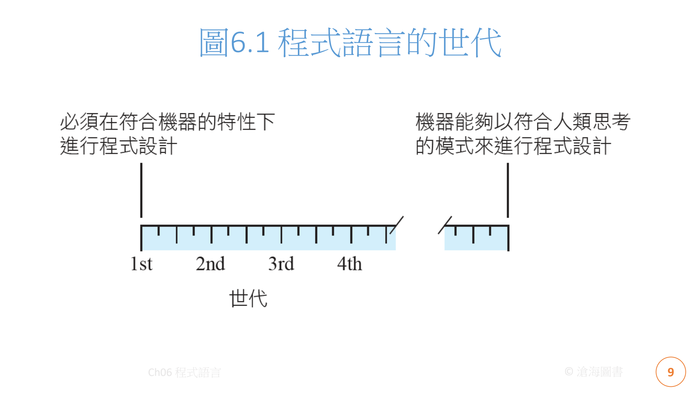

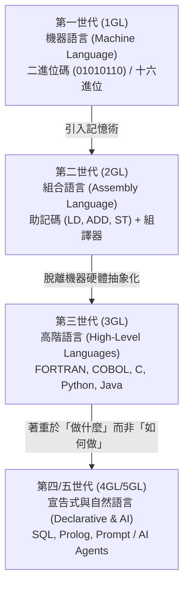

### 第一世代：機器語言 (1GL: Machine Language)
- **特徵**：由原始的二進位位元組 (0 與 1) 組成，直接由中央處理器 (CPU) 的硬體解碼電路執行。
- **範例**：`0x156C`（十六進位指令碼，對應 CPU 指令暫存器載入特定記憶體位址）。
- **缺點**：
  - 極端難以閱讀、除錯與維護（人腦難以記憶海量十六進位代碼）。
  - **強烈依賴特定硬體架構**：Intel x86 處理器的機器碼無法直接在 ARM 或 MIPS 架構上執行。

### 第二世代：組合語言 (2GL: Assembly Language)
- **核心發明**：引入**助記符號 / 記憶術 (Mnemonics)** 來替代枯燥的二進位操作碼 (Opcode)。
- **變數與識別碼**：允許程式設計師使用描述性名稱（如 `Price`, `Total`）代表記憶體位址。
- **範例**：
  ```assembly
  LD R5, Price    ; 將標籤為 Price 的記憶體資料載入暫存器 R5
  ```
- **核心工具**：**組譯器 (Assembler)**——負責將組合語言原始碼逐行一對一轉譯成目標機器碼。
- **局限性**：組合語言指令與底層 CPU 暫存器架構仍存在**一對一的嚴密對應關係**，程式設計師仍必須站在「硬體微架構」的角度思考，不具備可攜性 (Portability)。

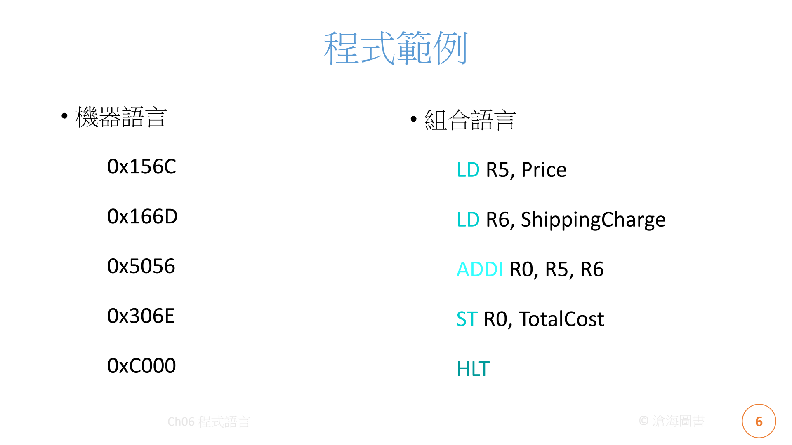
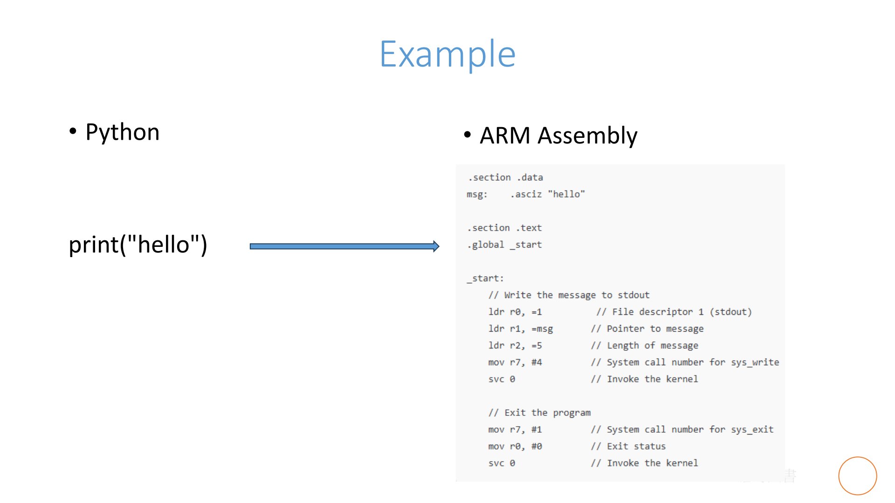

> **震撼對比：印出 "hello"**
> - **Python (3GL/高階語言)** 僅需一行：
>   ```python
>   print("hello")
>   ```
> - **ARM 組合語言 (2GL)** 則需撰寫十數行硬體系統呼叫：
>   ```assembly
>   .section .data
>   msg: .asciz "hello\n"
>   .section .text
>   .global _start
>   _start:
>       ldr r0, =1         // 檔案描述元 1 (stdout)
>       ldr r1, =msg       // 指向字串指標
>       ldr r2, =6         // 字串長度
>       mov r7, #4         // 系統呼叫號 4 (sys_write)
>       svc 0              // 呼叫 Linux 核心
>       mov r7, #1         // 系統呼叫號 1 (sys_exit)
>       mov r0, #0         // 回傳狀態碼 0
>       svc 0              // 結束程序
>   ```

### 第三世代：高階語言 (3GL: High-Level Languages)
- **代表語言**：FORTRAN（科學運算）、COBOL（商業資料處理）、BASIC、C、Pascal、C++、Java、Python。
- **核心革命**：
  - **與機器硬體無關 (Machine-Independent)**：程式碼寫在人類易讀的數學表達式與英文字彙層級，不再需要關心暫存器與記憶體具體位址。
  - **高階原式 (High-Level Primitives)**：支援複雜的算術表達式、迴圈 (`for`, `while`)、自訂函式與複合資料結構。
  - **編譯器 (Compiler) 與 直譯器 (Interpreter)**：自動將高階語法轉化為底層各平台的機器碼，實現跨平台編譯與執行。

---

## 2. 四大程式設計典範 (Programming Paradigms)

程式設計典範是指**組織程式碼、建模問題與推導演算法的思維架構與哲學風格**：

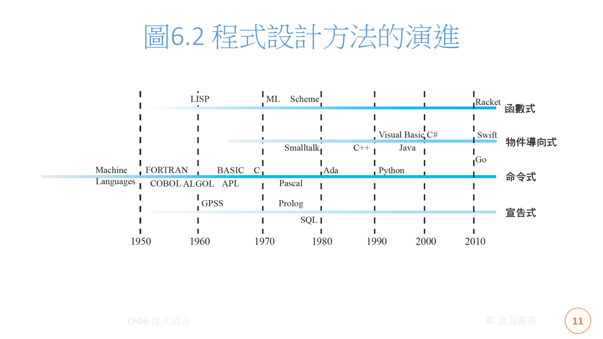
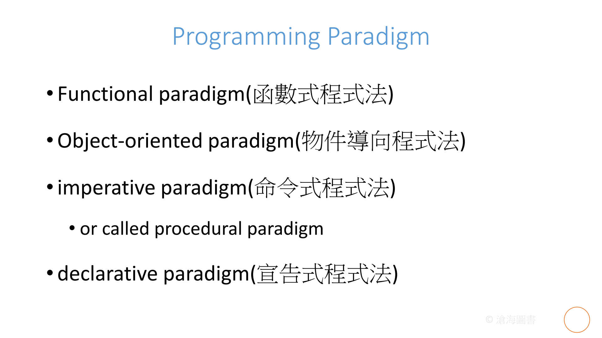

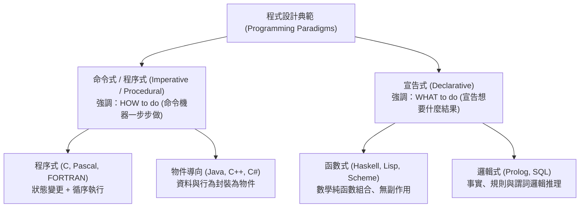

| 典範類別 | 核心思維 | 程式基本組成單元 | 狀態變化 (State) | 代表語言 |
| :--- | :--- | :--- | :--- | :--- |
| **命令式 / 程序式** *(Imperative / Procedural)* | 明確指定「一步步該如何改變記憶體狀態」以達成目標。 | 指令、陳述句 (Statements)、程序/函式。 | 依賴全域與區域可變變數 (Mutable Variables) 不斷指派更新。 | C, Pascal, FORTRAN, Python |
| **物件導向** *(Object-Oriented, OOP)* | 將世界抽象為「相互協作、傳遞訊息的自主物件實體」。 | 類別 (Class)、物件 (Object)、方法 (Method)。 | 狀態被嚴密封裝在各物件內部 (Encapsulated State)。 | Java, C++, C#, Python |
| **函數式** *(Functional)* | 視計算為「數學函數的嵌套與求值」，避免共享狀態與副作用。 | 純函數 (Pure Functions)、不可變資料 (Immutable Data)。 | **無狀態 (Stateless)**、變數一旦賦值即不可變更。 | Haskell, Lisp, Scheme, Erlang |
| **宣告式 / 邏輯式** *(Declarative / Logic)* | 僅宣告「問題的邏輯條件與目標是什麼」，由推論引擎自動推算。 | 查詢陳述 (Queries)、謂詞邏輯規則 (Rules & Facts)。 | 無指令計時器，透過圖形搜尋或關聯代數推導解答。 | SQL, Prolog |

### 函數式典範實例剖析：支票簿餘額計算 (Checkbook Balance)
講義圖 6.3 示範了函數式思維的核心：由簡易純函數 (Simple Functions) 組合建構成複合函數：

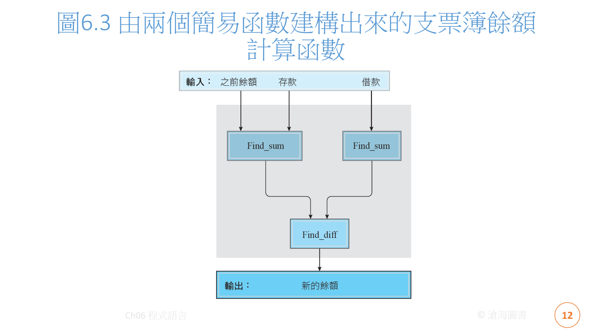

$$\text{NewBalance} = \text{CheckBookBalance}(\text{OldBalance}, \text{ChecksDeposited}, \text{ChecksWritten})$$
透過將多個不可變資料依序輸入純函數管道，完全不涉及全域變數的破壞性覆蓋。

---

## 3. 傳統命令式程式設計核心概念 (Traditional Programming Concepts)

高階命令式語言將底層的位元組與記憶體硬體包裝成三個由淺入深的抽象層級：
- **基本層 (Simple)**：常數 (Constants)、變數 (Variables)、純量資料型別 (Data Types)。
- **結構層 (Intermediate)**：指定陳述、運算式、流程控制結構。
- **模組層 (Advanced)**：程序 (Procedures)、函式庫 (Libraries)、套件模組。

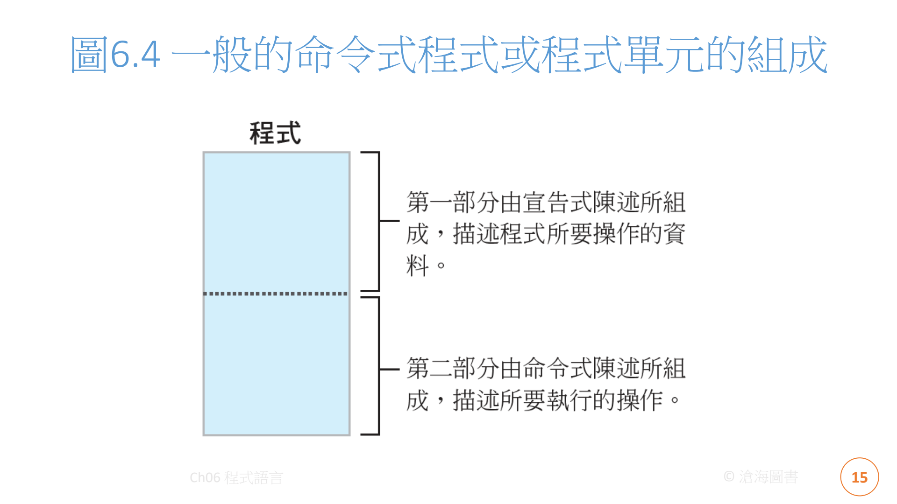

### 基本資料型別 (Fundamental Data Types)
電腦硬體底層全都是 0 與 1。**資料型別 (Data Type)** 決定了記憶體位元組應如何被解讀，以及該資料能夠執行哪些合法運算：

| 資料型別 (Data Type) | 英文名稱 | 典型佔用大小 | 說明與有效值範圍 |
| :--- | :--- | :---: | :--- |
| **整數型別** | `Integer (int)` | 2 ~ 4 Bytes | 無小數點的整數（如 `-42`, `0`, `2026`）。採用二補數編碼。 |
| **浮點數型別** | `Float / Double` | 4 ~ 8 Bytes | 帶小數點的實數（如 `3.14159`, `-0.001`）。採用 IEEE 754 標準浮點數格式。 |
| **字元型別** | `Character (char)` | 1 ~ 2 Bytes | 單一英文字母或符號（如 `'A'`, `'%'`）。採用 ASCII 或 Unicode (UTF-8) 編碼。 |
| **布林型別** | `Boolean (bool)` | 1 Byte | 邏輯真假值：`True` (真) 或 `False` (偽)。 |

---

### 二維陣列 (2D Array) 與 Row-Major 記憶體定址數學推導

陣列 (Array) 是一種**同質性 (Homogeneous)** 的循序資料結構，所有元素佔用大小相同且在記憶體中連續配置。

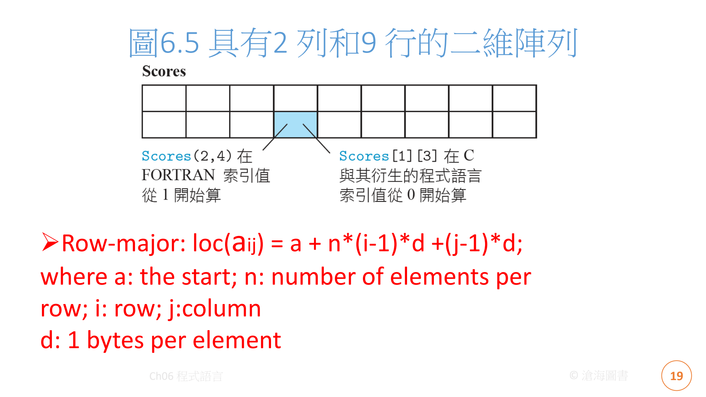

在電腦架構中，記憶體是一維線性連續定址空間（1D Linear Array）。當高階語言定義一個 $2 \times 9$（2 列 9 行）的矩陣時，作業系統通常採用**以列為主 (Row-major Order)** 的方式將矩陣展開成連續儲存空間。

#### 以列為主 (Row-major) 定址公式 (1-based Indexing, 課本標準):
$$\text{Loc}(A[i][j]) = \alpha + [n \times (i - 1) + (j - 1)] \times d$$

**各參數定義**：
- $\alpha$：陣列基底記憶體位址 (Base Address)
- $n$：每列包含的元素個數（即行數 Column Count）
- $i$：目標元素的列索引 (Row index, $1 \le i \le m$)
- $j$：目標元素的行索引 (Column index, $1 \le j \le n$)
- $d$：單一元素所佔用的位元組數量 (Size of element in bytes)

> 💡 **公式推導解析**：
> 1. 要存取第 $i$ 列的元素，前面已經完整排滿了 $(i - 1)$ 列，每列有 $n$ 個元素，共跳過 $(i - 1) \times n$ 個元素。
> 2. 在第 $i$ 列內部，目標元素位於第 $j$ 行，前面已經排了 $(j - 1)$ 個元素。
> 3. 兩者相加即為總共跳過之元素個數：$[n \times (i - 1) + (j - 1)]$。
> 4. 乘以單一元素大小 $d$ 並加上起始位址 $\alpha$，即可精確求得實體記憶體位址！

#### 實例計算：
假設 $\alpha = 1000$，$n = 9$（每列 9 個元素），$d = 1\text{ byte}$：
- 元素 $A[1][1]$ 位址：$1000 + [9 \times (1-1) + (1-1)] \times 1 = 1000$
- 元素 $A[1][9]$ 位址：$1000 + [9 \times (1-1) + (9-1)] \times 1 = 1008$
- 元素 $A[2][1]$ 位址：$1000 + [9 \times (2-1) + (1-1)] \times 1 = 1009$
- 元素 $A[2][9]$ 位址：$1000 + [9 \times (2-1) + (9-1)] \times 1 = 1017$

> 可執行 Python 驗證程式碼參見：[`code_examples/array_2d_memory.py`](../code_examples/array_2d_memory.py)

---

### 結構體 (Struct) 與聚合型別 (Aggregate Types)

與陣列要求「所有元素型別完全相同 (Homogeneous)」不同，**結構 (Structure / Struct)** 或**紀錄 (Record)** 是一種**異質性聚合型別 (Heterogeneous Aggregate Type)**，允許將多個不同型別的屬性打包於單一邏輯單元中：

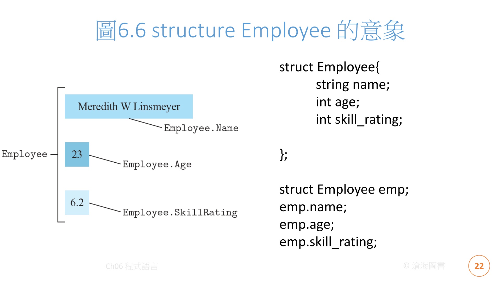

#### C 語言結構體定義 (投影片 P.22 範例)：
```c
struct Employee {
    string name;       // 字串型別
    int age;           // 整數型別
    int skill_rating;  // 整數型別
};

struct Employee emp;
emp.name = "Tony";
emp.age = 40;
emp.skill_rating = 100;
```

#### Python 模擬實作對照 (投影片 P.23 範例)：
```python
class Employee:
    def __init__(self, name: str, age: int, skill_rating: int):
        self.name = name
        self.age = age
        self.skill_rating = skill_rating

emp = Employee("Tony", 40, 100)
print("name:", emp.name)
print("age:", emp.age)
print("skill_rating:", emp.skill_rating)
```

> 可執行 Python 驗證程式碼參見：[`code_examples/struct_simulation.py`](../code_examples/struct_simulation.py)

---

## 4. 控制陳述與結構化程式設計 (Control Statements & Structured Programming)

### 結構化編程的里程碑：擺脫「義大利麵代碼 (Spaghetti Code)」
在 1960 年代前，早期程式大量使用無條件跳躍指令 `goto`，導致程式執行路徑交錯縱橫，除錯與理解極端困難。電腦科學巨擘 Edsger Dijkstra 於 1968 年發表經典論文《Go To Statement Considered Harmful》，推動了**結構化程式設計運動 (Structured Programming)**。

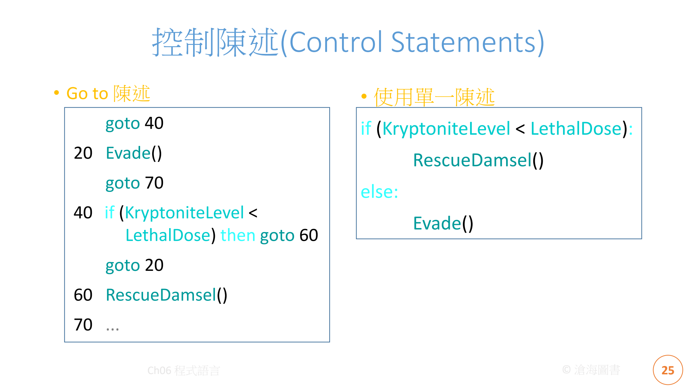

### 現代三大結構化流程控制：

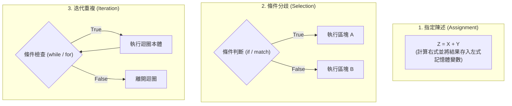

#### 條件分支比較 (If-Else vs Switch vs Python Match-Case)
在 C/C++/Java 中採用 `switch-case`，而在現代 Python 3.10+ 中則導入強大的結構化模式比對 (`match-case`)：

```python
# Python 3.10+ 結構化模式比對 (對應講義 P.29)
var = "A"
match var:
    case "A":
        print("A")
    case "B":
        print("B")
    case _:
        print("None (預設匹配)")
```

#### For 迴圈的標準三要素語法架構 (圖 6.7)
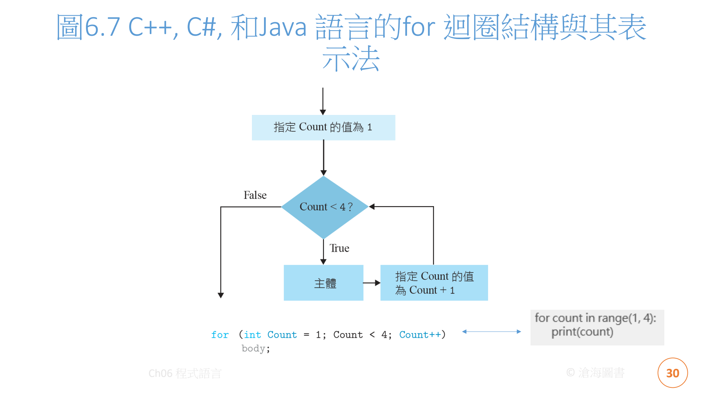

```c
for (initialization; condition; increment/update) {
    body_statements;
}
```
1. **初始化 (Initialization)**：迴圈開始前僅執行一次（例如 `int i = 0`）。
2. **終止條件 (Condition / Invariant)**：每次迴圈本體執行前進行前測試檢查（例如 `i < 10`）。
3. **步進更新 (Increment / Step)**：每次本體執行完畢後對迴圈控制變數進行增減（例如 `i++`）。

---

## 5. 程序單元與函式呼叫機制 (Procedural Units & Functions)

### 概念命名與層次
在計算機科學中，封裝可重複執行之一段邏輯的抽象單元，在不同歷史時期與程式語言中有名稱上的差異：
- **副程式 (Subprogram)**：通用通稱。
- **程序 (Procedure)**：通常指「不回傳計算結果，著重於執行特定動作 (Action)」的副程式。
- **函數 / 函式 (Function)**：通常指「接收輸入引數，並透過 `return` 回傳單一計算數值」的副程式。
- **方法 (Method)**：在物件導向程式語言中，依附於特定類別或物件內部的函式。

### 函式呼叫的控制流程與呼叫堆疊 (Call Stack)
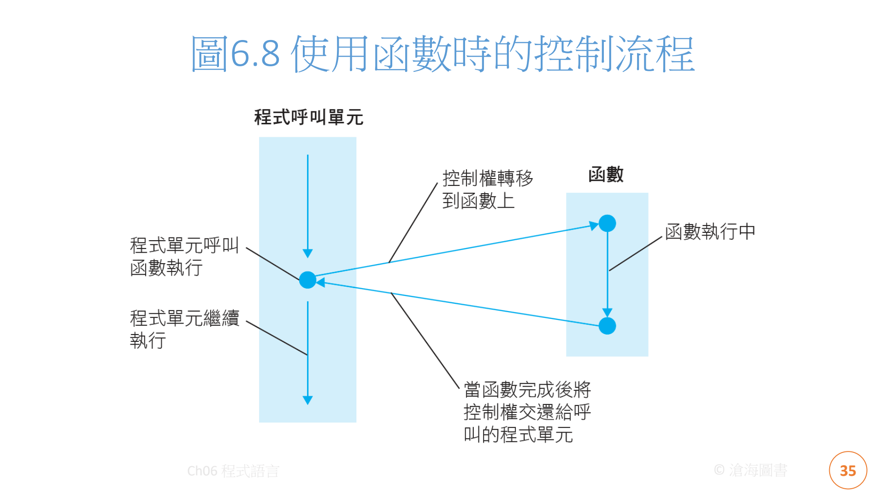

當主程式呼叫副程式時，系統會在主記憶體中分配一個**活動紀錄 (Activation Record / Stack Frame)**，壓入呼叫堆疊 (Call Stack) 中：
1. **儲存返回位址 (Return Address)**：記錄副程式執行完畢後應返回主程式的下一行指令位址。
2. **分配區域變數 (Local Variables)**：為副程式內部專屬的變數配置記憶體空間，與外部變數隔離。
3. **轉移程式計數器 (PC)**：CPU 跳轉至副程式的第一行代碼開始執行。
4. **回傳與釋放**：執行 `return` 時，彈出堆疊訊框，銷毀區域變數，並跳回原返回位址繼續執行。

---

### 參數傳遞機制剖析：傳值 (Call by Value) vs 傳址 (Call by Reference)

這是在考試與系統程式設計中極其關鍵的核心觀念！

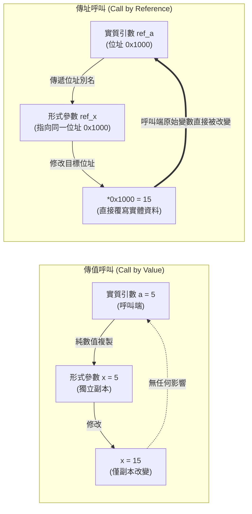

#### 1. 傳值呼叫 (Call by Value, 投影片圖 6.10 逐步追蹤)：
- **定義**：呼叫端將實質引數的**「數值拷貝 (Copy of Value)」**傳遞給副程式的形式參數。
- **空間隔離**：形式參數在副程式的堆疊訊框中擁有獨立的儲存空間。
- **副作用 (Side Effect)**：副程式內部對形式參數的任何重新指派或修改，**完全不會影響呼叫端的原始變數**。
- **優缺點**：
  - *優點*：資料隔離安全性高，避免呼叫端資料意外受污染。
  - *缺點*：若傳遞大型物件（如百萬元素陣列），複製整個資料結構會消耗大量時間與記憶體。

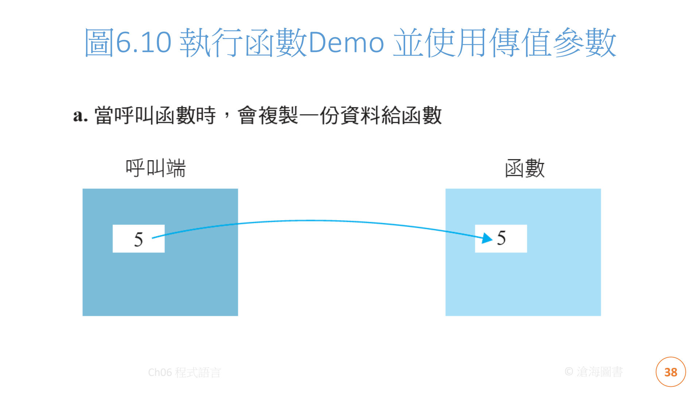
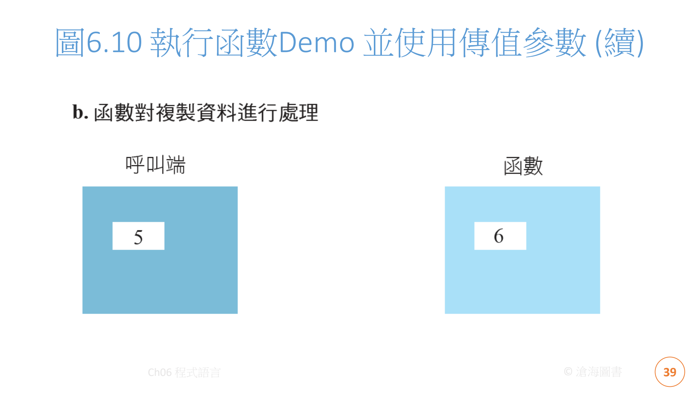
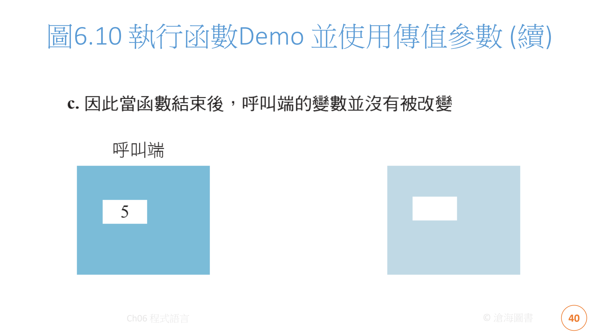

#### 2. 傳址呼叫 (Call by Reference, 投影片圖 6.11 逐步追蹤)：
- **定義**：呼叫端傳遞實質引數的**「實體記憶體位址 (Memory Address / Pointer)」**給形式參數。
- **位址別名**：形式參數直接成為呼叫端原始變數的**別名 (Alias)**。
- **副作用**：副程式對形式參數的修改，會**即時且永久地直接反映在呼叫端的原始變數上**！
- **優缺點**：
  - *優點*：傳遞記憶體指標極快（通常僅需 4 或 8 位元組），適合處理龐大資料。
  - *缺點*：失去資料隔離性，容易產生難以追蹤的隱式副作用。

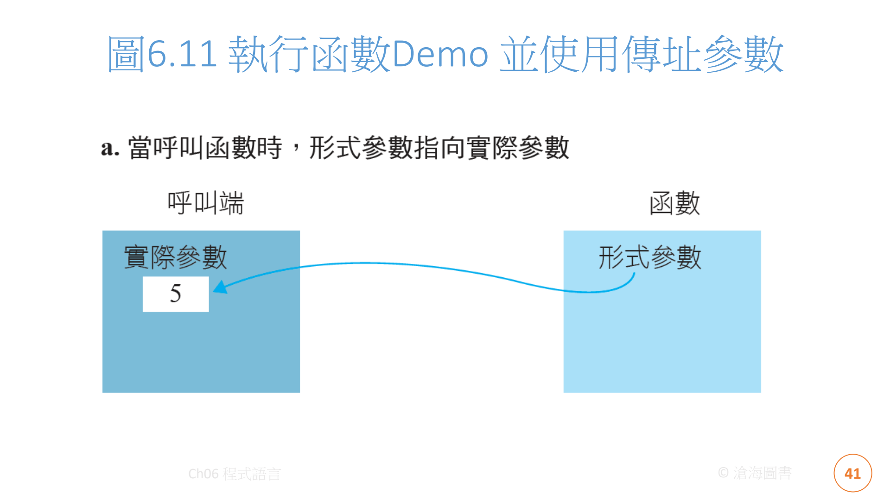
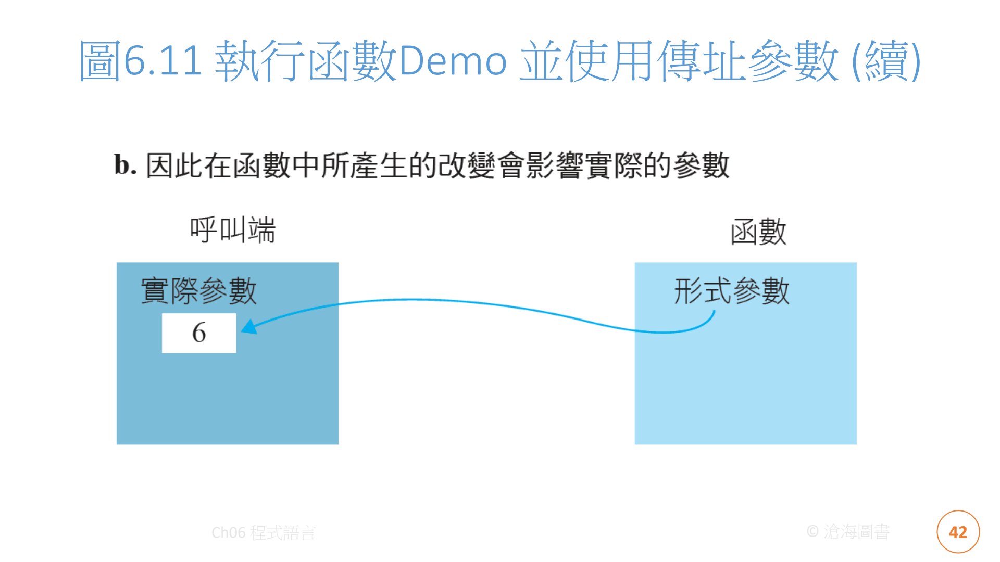
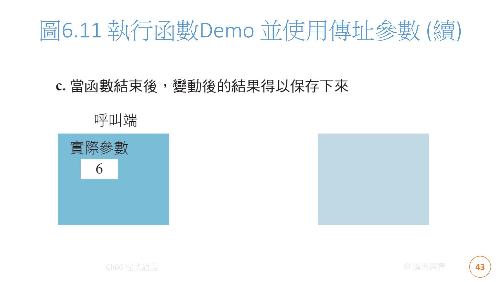

> 可執行 Python 模擬與驗證程式碼參見：[`code_examples/parameter_passing.py`](../code_examples/parameter_passing.py)

---

## 6. 物件導向程式設計核心 (Object-Oriented Programming, OOP)

物件導向思維主張將真實世界建模為**「資料 (屬性/狀態)」**與**「處理該資料的行為 (方法)」**高度結合的自主實體。

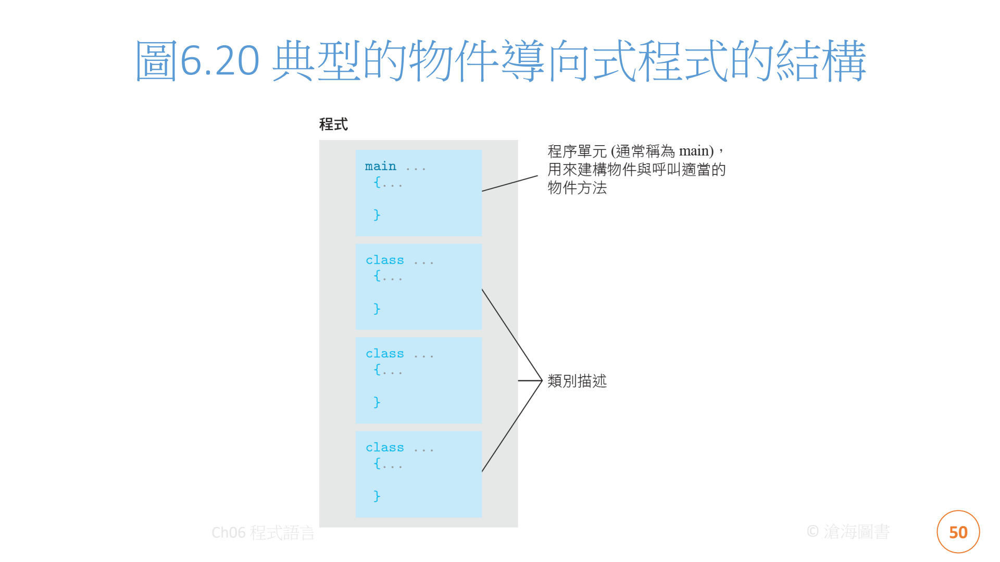

### 類別 (Class) 與 物件 (Object) 的本質對照：
- **類別 (Class)**：物件的**模版、藍圖或抽象規格書 (Template / Blueprint)**。定義了該型態的實體將擁有何種屬性與何種行為。
- **物件 (Object / Instance)**：依據類別藍圖在記憶體中具體動態實體化出來的**實例 (Concrete Instance)**。

```text
       【類別 Class (藍圖)】
        LaserClass
       ┌────────────────────────┐
       │ - __RemainingPower     │  <--- 屬性 (Attributes / State)
       │ + Name                 │
       ├────────────────────────┤
       │ + turnLeft()           │  <--- 方法 (Methods / Behavior)
       │ + turnRight()          │
       │ + fire()               │
       │ + readEngery()         │
       └────────────────────────┘
                   │
         實體化 (Instantiation)
       ┌───────────┴───────────┐
       ▼                       ▼
【物件 Instance 1】       【物件 Instance 2】
Laser1 (Name: "Tsai")   Laser2 (Name: "Chen")
Power: 100              Power: 50
```

### 物件完整性與封裝 (Encapsulation & Visibility)
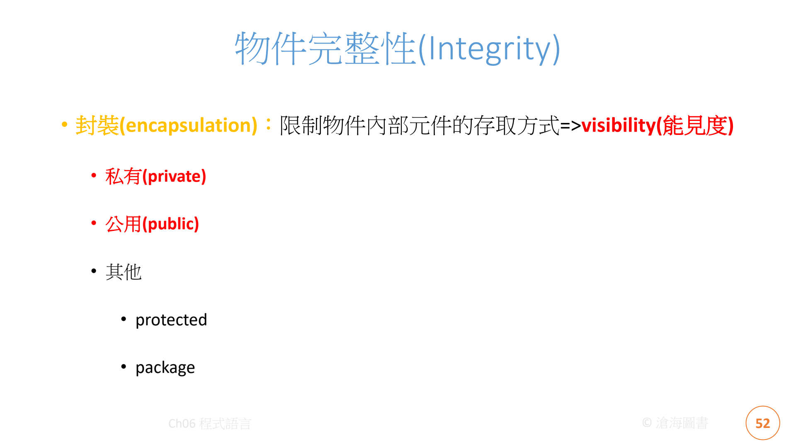

**封裝 (Encapsulation)** 是物件導向的第一大支柱，其核心目的為**資訊隱藏 (Information Hiding)**：
- **私有成員 (Private, `-`)**：限制僅有類別內部的方法可直接讀寫。防止外部任意修改或破壞物件的不變量與內部狀態（如雷射槍電量不可被外部直接竄改為負值）。
- **公用成員 (Public, `+`)**：對外公開之標準 API 操作介面（如 `fire()`, `turnRight()`）。
- **受保護成員 (Protected, `#`)**：僅允許本身類別及其繼承之子類別存取。

### 生命週期管理：建構子 (Constructor) 與解構子 (Destructor)
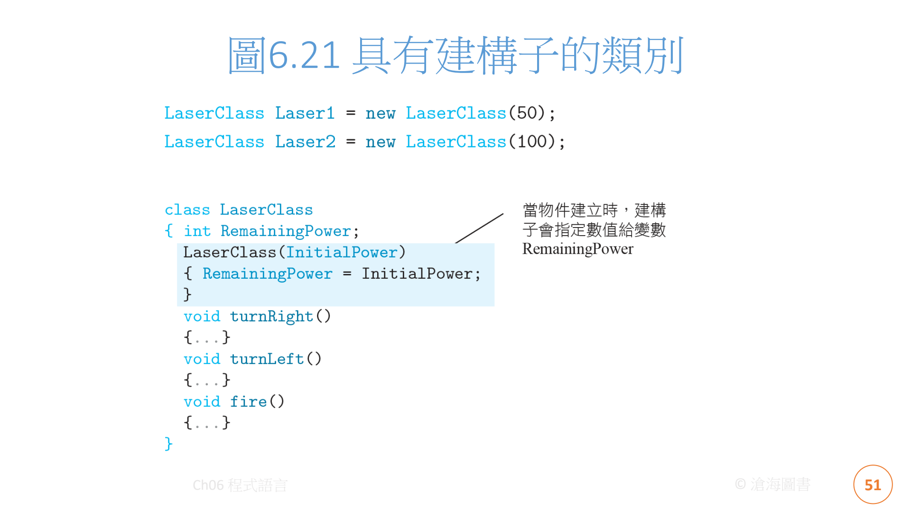

1. **建構子 (Constructor)**：
   - 當物件透過 `new` 或 `ClassName()` 建立時由系統自動呼叫。
   - 負責為實例變數進行初始化、配置系統資源與檢查前置條件。
   - 在 Python 中為 `__init__(self, ...)`；在 C++/Java 中為與類別同名之函式。
2. **解構子 (Destructor)**：
   - 當物件生命週期結束（超出範疇或被 `del` 回收）時由系統自動觸發。
   - 負責釋放物件佔用之外部資源（如關閉檔案、中斷網路連線、釋放記憶體）。
   - 在 Python 中為 `__del__(self)`；在 C++ 中為 `~ClassName()`。

### 課堂實戰範例：雷射槍武器 (LaserClass)
投影片 P.48~54 透過雷射槍案例完整貫穿了物件導向設計：

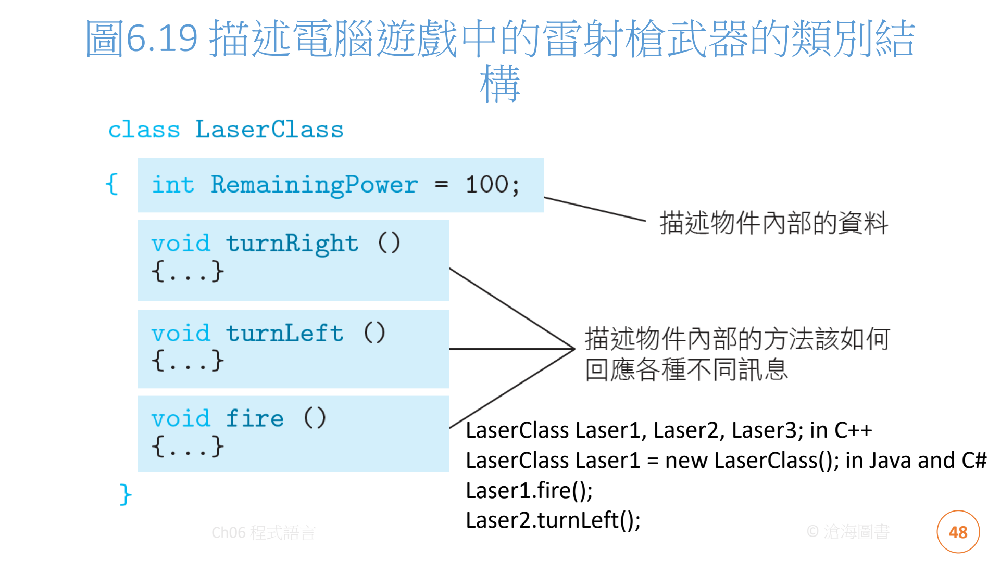
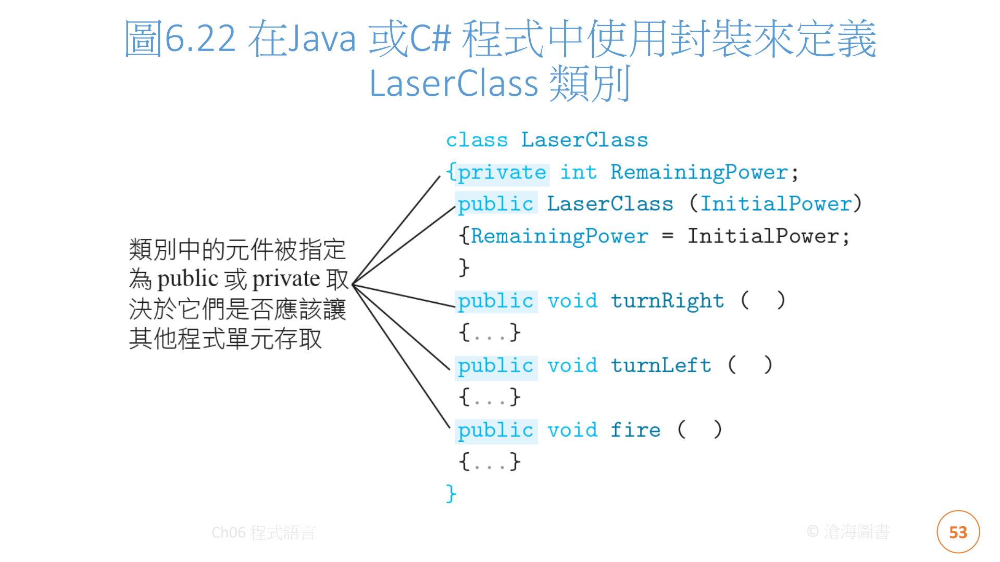
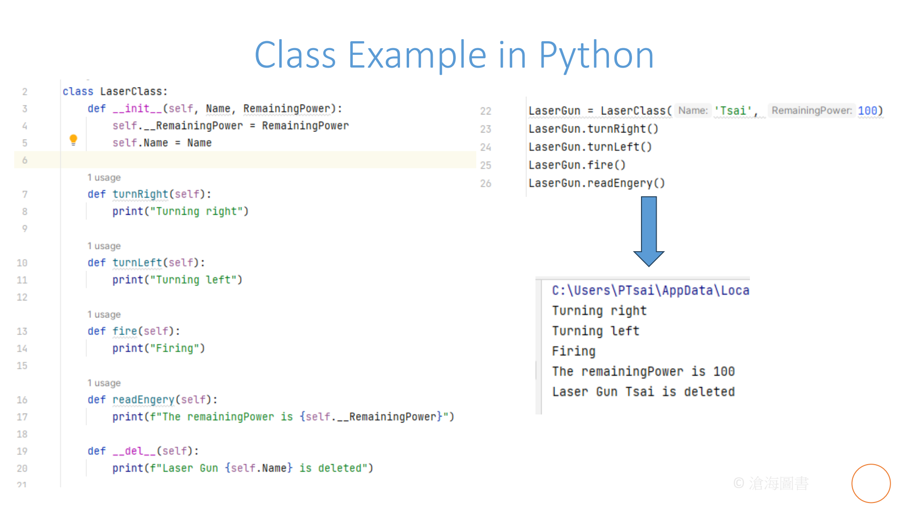

```python
class LaserClass:
    def __init__(self, name: str, remaining_power: int = 100):
        # 私有變數 (Private Attribute): 限制外部直接存取
        self.__RemainingPower = remaining_power
        # 公用變數 (Public Attribute)
        self.Name = name

    def turnRight(self):
        print("Turning right")

    def turnLeft(self):
        print("Turning left")

    def fire(self):
        if self.__RemainingPower >= 10:
            self.__RemainingPower -= 10
            print("Firing")
        else:
            print("Out of power")

    def readEngery(self):
        print(f"The remainingPower is {self.__RemainingPower}")

    def __del__(self):
        print(f"Laser Gun {self.Name} is deleted")
```

> 可執行 Python 完整實作程式碼參見：[`code_examples/oop_laser_gun.py`](../code_examples/oop_laser_gun.py)

---

## 7. 物件導向進階：繼承與多型 (Inheritance & Polymorphism)

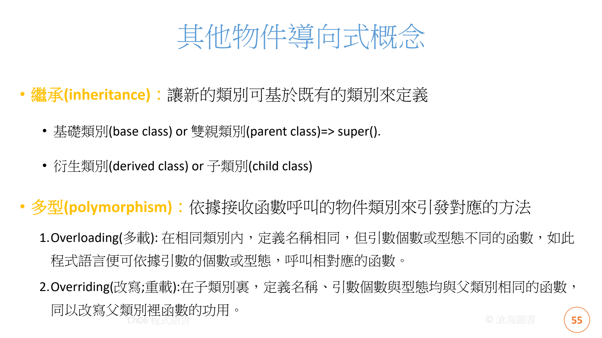

### 繼承 (Inheritance)
- **概念**：允許一個新類別（**衍生類別 / 子類別 Derived / Child Class**）基於既有的類別（**基礎類別 / 父類別 Base / Parent Class**）進行擴充或特化。
- **好處**：實現代碼重複使用 (Code Reuse)，建立「is-a（是一種）」的語意層級架構。
- **`super()` 機制**：子類別可直接調用父類別之建構子或既有方法，繼承並擴展通用特性。

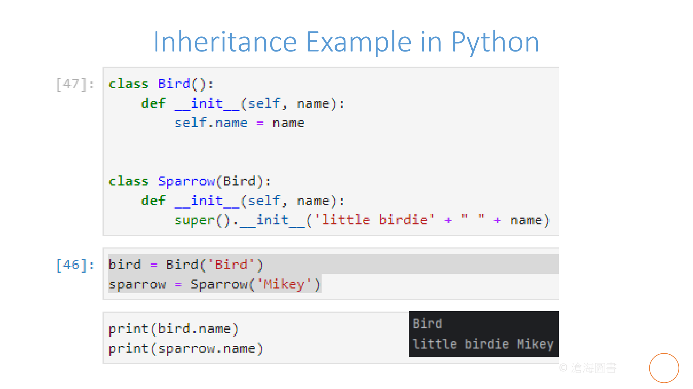

```python
class Bird:
    def __init__(self, name: str):
        self.name = name

class Sparrow(Bird):
    def __init__(self, name: str):
        # 呼叫父類別建構子
        super().__init__("little birdie " + name)
```

---

### 多型 (Polymorphism)：Overloading vs Overriding 關鍵辨析

**多型 (Polymorphism)** 意指「單一共同介面，多種專屬實作行為」。其主要分為兩大機制：

| 比較維度 | 多載 (Overloading) | 改寫 / 覆寫 (Overriding) |
| :--- | :--- | :--- |
| **定義位置** | 發生在**同一個類別 (Same Class)** 內部。 | 發生在**具繼承關係的父子類別**之間。 |
| **函式名稱** | **相同名稱**。 | **相同名稱**。 |
| **參數規格** | **參數個數不同** 或 **參數型態不同**。 | **參數個數與型態皆必須完全一致**。 |
| **分派時期** | 通常為編譯期靜態繫結 (Compile-time / Static Binding)。 | 通常為執行期動態繫結 (Runtime / Dynamic Binding)。 |
| **核心目的** | 提供相同操作針對不同輸入型態的便利介面。 | 子類別特化或改寫父類別的預設行為。 |

#### 1. 多載 (Overloading) 實例 (投影片 P.57):
在同一類別中定義不同參數型別之同名函式：
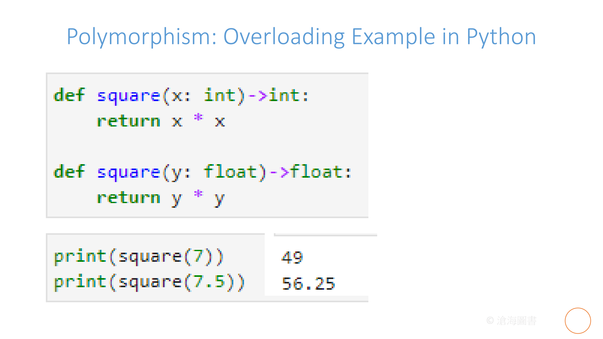

```python
# 依據參數型別計算平方
square(x: int) -> int: return x * x
square(y: float) -> float: return y * y
```

#### 2. 改寫 (Overriding) 實例 (投影片 P.58):
子類別重新定義父類別的方法以展現特化動作：
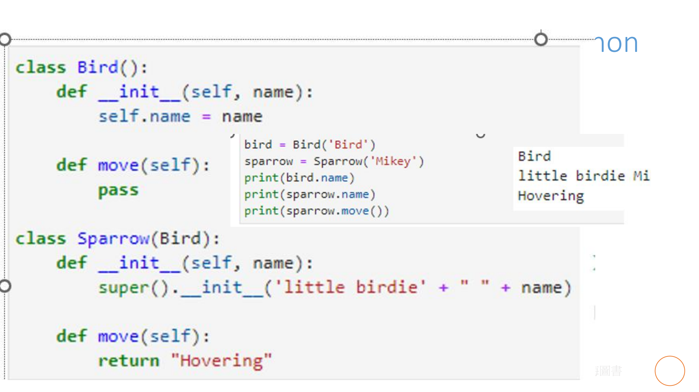

```python
class Bird:
    def move(self):
        return "Flying normally"

class Sparrow(Bird):
    def move(self):
        # 改寫父類別預設行為
        return "Hovering"
```

> 可執行 Python 繼承與多型實作程式碼參見：[`code_examples/oop_inheritance_polymorphism.py`](../code_examples/oop_inheritance_polymorphism.py)

---

## 8. 課堂隨堂練習深度題解 (In-Class Exercises Deep Dive)

### In-Class Exercise 3.1 (投影片 P.13)

> **題目一：命令式程式法著重於描述導引解決問題的步驟，試概述宣告式程式法、函數式程式法與物件導向式程式法。**

**標準題解**：
1. **宣告式程式法 (Declarative Paradigm)**：
   - 不關心具體的執行控制流程（How），而是著重於「宣告問題的本質與期望得到的結果（What）」。
   - 範例：SQL 查詢語言（僅宣告 `SELECT name FROM student WHERE score > 60;`，由資料庫引擎最佳化搜尋步驟）。
2. **函數式程式法 (Functional Paradigm)**：
   - 視運算為數學純函數之求值與組合，避免共享狀態、可變資料 (Immutable) 與副作用 (Side Effects)。
   - 每個函數輸入相同的引數必回傳相同的結果，極度適合高並發平行運算。
3. **物件導向程式法 (Object-Oriented Paradigm)**：
   - 將現實實體建模為結合「資料狀態 (State)」與「操作方法 (Behavior)」的封裝物件。
   - 透過物件間相互傳遞訊息來達成複雜系統協作，具備高模組化與可維護性。

> **題目二：What is Cross-Platform Software?（什麼是跨平台軟體？）**

**標準題解**：
- **跨平台軟體 (Cross-Platform Software)** 指的是能夠在多種不同的作業系統（如 Windows, macOS, Linux, Android, iOS）以及不同的硬體微架構（如 x86, ARM, RISC-V）上順利編譯或執行的軟體應用程式。
- 通常透過高階語言直譯器（如 Python 直譯器）、虛擬機器（如 Java Virtual Machine, JVM）或跨平台抽象函式庫達成。

> **題目三：What are natural languages and formal languages?（什麼是自然語言與正規語言？）**

**標準題解**：
- **自然語言 (Natural Languages)**：人類在歷史演化過程中自然形成的日常交流語言（如繁體中文、英文）。特點是**文法具彈性、富含語境、但也存在大量語意歧義性 (Ambiguity)**。
- **正規語言 (Formal Languages)**：人為精確定義、具備嚴格數學文法與語義規則的語言（如程式語言 Python、C++、數學符號系統、虛擬碼）。特點是**語法嚴謹、毫無語意二義性 (Unambiguous)**，能夠被計算機演算法精確解析與執行。

---

### In-Class Exercise 3.2 (投影片 P.33)

> **題目：試問陣列 (Array) 與聚合型別 (Aggregate Type / Struct) 有何差異？**

**標準題解**：
| 比較維度 | 陣列 (Array) | 聚合型別 / 結構體 (Struct / Aggregate Type) |
| :--- | :--- | :--- |
| **資料同質性** | **同質性 (Homogeneous)**：所有內部元素必須屬於完全相同的資料型別（例如全部為 `int`）。 | **異質性 (Heterogeneous)**：內部不同欄位可包含互不相同的型別（如字串、整數、浮點數混合打包）。 |
| **元素存取方式** | 透過整數**索引下標 (Integer Index)** 循序或隨機存取（例如 `scores[0]`, `matrix[1][2]`）。 | 透過描述性**欄位名稱 (Field Identifier / Member Name)** 存取（例如 `emp.name`, `emp.age`）。 |
| **記憶體佈局** | 連續且等距的記憶體區塊配置，可直接透過算術公式定址。 | 連續記憶體配置，但各欄位大小依型別而異，且底層可能涉及記憶體位元組對齊 (Data Structure Alignment / Padding)。 |
| **主要應用場景** | 儲存大量性質相同、具數值序號之資料清單或矩陣。 | 描述具體實體物件（如學生紀錄、商品資訊）之多屬性資料集合。 |

---

### In-Class Exercise 3.3 (投影片 P.46)

> **題目：試問傳址參數 (Call by Reference) 與傳值參數 (Call by Value) 的函數差異為何？**

**標準題解**：
1. **傳遞內容本質**：
   - **傳值 (Call by Value)**：呼叫端複製實質引數的**「數值內容」**至被呼叫端的形式參數。
   - **傳址 (Call by Reference)**：呼叫端將實質引數的**「記憶體位址 / 指標」**傳遞給被呼叫端。
2. **記憶體空間獨立性**：
   - 傳值呼叫會在副程式之堆疊訊框內分配獨立的記憶體副本；傳址呼叫的形式參數直接指向呼叫端現有記憶體位置，成為該變數的別名。
3. **副作用 (Side Effect)**：
   - 傳值呼叫中，副程式內部對形式參數的任何數值變更，**完全不會影響呼叫端的原始變數**。
   - 傳址呼叫中，副程式內部對參數內容的寫入，**會即時同步改變呼叫端記憶體中的原始變數**。
4. **效能與安全性權衡**：
   - 傳值安全隔離度高，但傳遞超大型資料結構時記憶體拷貝成本巨大；傳址傳遞極快且記憶體佔用極小，但破壞了變數的封閉性與純粹性。

---

### In-Class Exercise 3.5 (投影片 P.59)

> **題目：試問為何類別中有些元素會被指定為 private？**

**標準題解**：
將類別內部元素（尤其是實例變數）指定為 `private`，是物件導向**「封裝 (Encapsulation)」**與**「資訊隱藏 (Information Hiding)」**核心原則的具體體現，其關鍵理由如下：
1. **保護物件內部狀態的完整性 (Integrity & Invariant Protection)**：
   - 防止外部程式碼未經檢驗任意修改關鍵屬性（例如：防止外部隨意將雷射槍電量設為負值，或將銀行帳戶餘額竄改為非法數值）。
2. **降低模組耦合度 (Low Coupling)**：
   - 外部程式僅需依賴公開介面 (Public API/Methods)，不需知道內部資料結構如何實作。日後若類別內部實作改變（例如由陣列改為雜湊表），外部呼叫程式碼完全不需修改。
3. **實現控制存取驗證 (Controlled Access & Validation)**：
   - 強制外部必須透過 Getter / Setter 或特定業務邏輯方法讀寫資料，讓類別能在方法內部進行合規檢查、權限審核或觸發事件更新。

---

## 9. 專業術語中英對照表 (Bilingual Terminology Table)

| 英文術語 (English Term) | 繁體中文對照 (Traditional Chinese) | 詳細定義與專業意涵 (Definition & Context) |
| :--- | :--- | :--- |
| **Machine Language** | 機器語言 | 由二進位 0 與 1 組成、直接由 CPU 硬體執行解碼的底層第一代程式語言。 |
| **Assembly Language** | 組合語言 | 使用助記術符號 (Mnemonics) 描述機器指令的第二代硬體相關語言。 |
| **High-Level Language** | 高階語言 | 與機器硬體無關、貼近人類自然思考與數學表達式的第三代語言 (如 Python, C)。 |
| **Compiler / Interpreter** | 編譯器 / 直譯器 | 將高階語言原始碼整批編譯成機器二進位碼，或逐行直譯執行的核心語言轉換工具。 |
| **Programming Paradigm** | 程式設計典範 | 組織與建構程式碼、描述計算邏輯的思維架構與工程哲學 (命令、物件、函數、宣告)。 |
| **Imperative Paradigm** | 命令式 / 程序式典範 | 著重於具體描述「一步步如何改變記憶體狀態」以達成目標的編程方法。 |
| **Declarative Paradigm** | 宣告式典範 | 著重於描述「計算的目標與邏輯是什麼」，而非具體控制步驟的編程方法 (如 SQL)。 |
| **Functional Paradigm** | 函數式典範 | 視計算為數學純函數之求值，嚴格強調不可變性 (Immutability) 與無副作用。 |
| **Object-Oriented (OOP)** | 物件導向程式設計 | 將世界抽象為具備封裝屬性與行為之自主物件實體的編程典範。 |
| **Row-Major Order** | 以列為主之記憶體排列 | 二維矩陣在平坦線性記憶體中依序先填滿整列再進入下一列的定址配置方式。 |
| **Aggregate Type / Struct** | 聚合型別 / 結構體 | 將多個不同資料型別之欄位打包成單一邏輯實體的異質性複合資料結構。 |
| **Procedural Unit** | 程序單元 | 副程式、函式、程序、方法之總稱，具備獨立作用域與控制流程跳轉機制。 |
| **Call by Value** | 傳值呼叫 | 呼叫端將數值複製給形式參數，副程式內部修改不影響呼叫端原始變數。 |
| **Call by Reference** | 傳址呼叫 | 呼叫端傳遞實體記憶體位址，形式參數為變數別名，內部修改直接影響呼叫端。 |
| **Activation Record / Stack Frame** | 活動紀錄 / 堆疊訊框 | 函式呼叫時在呼叫堆疊中動態建立、用於保存返回位址與區域變數之記憶體單元。 |
| **Class vs Object** | 類別 vs 物件 | 類別為建構物件的抽象模板藍圖；物件為類別在記憶體中具體實體化的實例。 |
| **Encapsulation** | 封裝 | 將資料與操作方法打包於物件內，並利用能見度控制實現資訊隱藏的機制。 |
| **Information Hiding** | 資訊隱藏 | 將模組內部實作細節與關鍵狀態對外隱藏，僅暴露穩定介面的軟體工程原則。 |
| **Constructor / Destructor** | 建構子 / 解構子 | 物件建立實體化時自動執行的初始化方法 / 物件被釋放銷毀時執行的清理方法。 |
| **Inheritance** | 繼承 | 子類別基於父類別擴充屬性與方法，實現程式碼重複利用與 is-a 概念階層。 |
| **Polymorphism** | 多型 | 單一共同介面，在不同衍生子類別中展現專屬多樣化行為之物件導向特徵。 |
| **Method Overloading** | 方法多載 | 在相同類別中定義名稱相同，但引數個數或型態不同的多個函式版本。 |
| **Method Overriding** | 方法改寫 / 覆寫 | 在子類別中重新定義與父類別名稱、參數完全一致的方法，以特化父類別行為。 |

---

## 👨‍🏫 模組總結與回顧 (Module Summary)
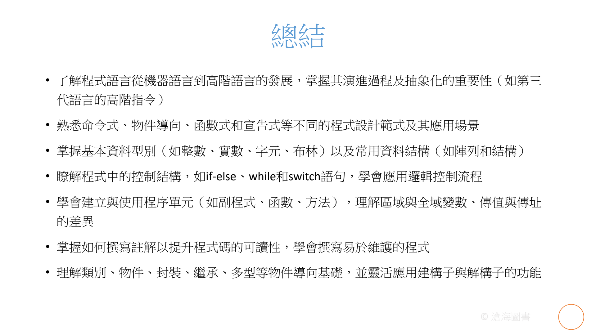

1. **抽象化之梯**：程式語言歷經 1GL (機器碼) $\to$ 2GL (組合語言) $\to$ 3GL (高階語言) $\to$ 4GL (宣告式)，每一步都在抽離底層硬體細節，解放人類的工程創造力。
2. **典範之美**：命令式著重流程狀態、物件導向著重實體封裝、函數式著重純粹運算、宣告式著重邏輯目標。掌握多典範思維是成為頂尖資工人才的核心素養。
3. **記憶體與控制深層感知**：無論高階語法如何簡潔，底層依然依賴二維陣列定址公式、呼叫堆疊訊框與傳值/傳址等精密的計算機系統機制。
4. **物件導向三角架構**：以**封裝**確保資料完整性、以**繼承**消除冗餘代碼、以**多型**實現軟體的高可擴充性與開放封閉原則 (OCP)。
