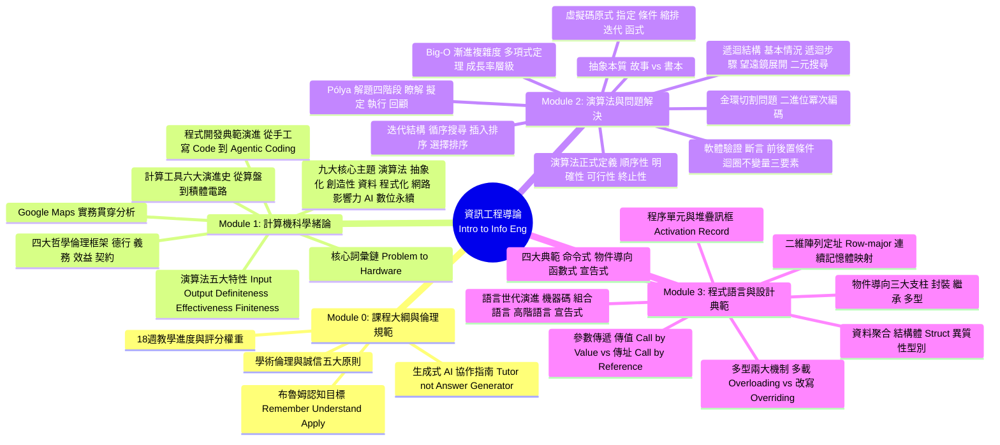

# 國立虎尾科技大學 - 資訊工程導論 課程全方位精華筆記
### Introduction to Information Engineering (NFU CSIE)

[](https://github.com/Nono0325/Intro.-to-Info.-Eng.)
[](https://www.pearson.com)
[](https://www.python.org/)
[](#)

本倉儲為**國立虎尾科技大學資訊工程系「資訊工程導論」**課程之完整、系統化學習筆記與實作代碼庫。內容深度整合授課投影片精髓、教科書 (*Computer Science: An Overview*, 13th Edition) 核心理論，並包含**詳細觀念解析**、**中英對照翻譯**、**專業術語辭典**、**高解析度投影片圖解**與**可直接執行的 Python 實作程式碼**。

---

## 🗺️ 課程知識地圖 (Course Knowledge Roadmap)



---

## 📚 模組章節導航 (Modules Navigation)

| 模組目錄 | 主題單元 | 課本章節 | 重點內容提要 | 快速傳送門 |
| :--- | :--- | :---: | :--- | :---: |
| **Module 0** | **課程大綱與學習指引**<br/>*(Course Syllabus & Guide)* | Syllabus | 評分標準、18 週進度表、布魯姆認知層級、學術倫理與生成式 AI 使用 SOP、MIT 腦波反思。 | [前往閱讀 📖](00_Course_Syllabus/README.md) |
| **Module 1** | **計算機科學緒論與核心思維**<br/>*(Introduction to CS)* | Ch 0 | 詞彙鏈、演算法五大特性、輾轉相除法推演、計算機歷史六大階段、九大核心主題、AI 時代為何學 CS、四大倫理框架。 | [前往閱讀 📖](01_Introduction_to_CS/README.md) |
| **Module 2** | **演算法與問題解決全解析**<br/>*(Algorithms & Problem Solving)* | Ch 5 | 演算法定義、摺紙原式、Pólya 解題法、小孩年齡與賽跑問題、迭代 vs 遞迴、插入排序追蹤、二元搜尋、Big-O、金環問題、迴圈不變量。 | [前往閱讀 📖](02_Algorithms_and_Problem_Solving/README.md) |
| **Module 3** | **程式語言與設計典範全解析**<br/>*(Programming Languages)* | Ch 6 | 語言世代演進、四大典範、二維陣列 Row-major 定址公式、Struct 模擬、傳值 vs 傳址堆疊訊框追蹤、OOP 封裝繼承多型 (LaserClass & Bird)。 | [前往閱讀 📖](03_Programming_Languages/README.md) |

---

## 💻 課堂演算法 Python 程式碼庫 (Executable Code Examples)

本倉儲提供所有課堂探討之演算法的可執行 Python 程式碼，均附有完整繁體中文註解與測試資料：

| 檔案名稱 | 演算法 / 課題名稱 | 對應講義單元 | 時間複雜度 | 原始碼連結 |
| :--- | :--- | :---: | :---: | :---: |
| `gcd_euclidean.py` | 歐幾里得輾轉相除法 (減法版 / 取模版 / 遞迴版) | Module 1 (圖0.2) | $O(\log(\min(M, N)))$ | [檢視原始碼 ↗](code_examples/gcd_euclidean.py) |
| `largest_product_set.py` | 正整數最大乘積拆解問題 (貪婪/數學解法) | Module 2 (P.37~39) | $O(n)$ | [檢視原始碼 ↗](code_examples/largest_product_set.py) |
| `sequential_search.py` | 循序搜尋法 (線性搜尋) | Module 2 (圖5.6) | $O(n)$ | [檢視原始碼 ↗](code_examples/sequential_search.py) |
| `insertion_sort.py` | 插入排序法 (逐步撲克牌摸牌追蹤) | Module 2 (圖5.10~5.11) | $O(n^2)$ | [檢視原始碼 ↗](code_examples/insertion_sort.py) |
| `selection_sort.py` | 選擇排序法 (極值交換追蹤) | Module 2 (P.55) | $O(n^2)$ | [檢視原始碼 ↗](code_examples/selection_sort.py) |
| `binary_search_iterative.py` | 二元搜尋法 - 迭代版本 (二分折半) | Module 2 (P.60) | $O(\log n)$ | [檢視原始碼 ↗](code_examples/binary_search_iterative.py) |
| `binary_search_recursive.py` | 二元搜尋法 - 遞迴版本 (堆疊階層追蹤) | Module 2 (圖5.14~5.17) | $O(\log n)$ | [檢視原始碼 ↗](code_examples/binary_search_recursive.py) |
| `fibonacci_factorial.py` | 階乘與費氏數列 (遞迴 vs 迭代開銷比對) | Module 2 (P.43~46) | 多種 | [檢視原始碼 ↗](code_examples/fibonacci_factorial.py) |
| `loop_invariant_demo.py` | 迴圈不變量三要素驗證與 Assertion 斷言 | Module 2 (P.87~89) | $O(n)$ | [檢視原始碼 ↗](code_examples/loop_invariant_demo.py) |
| `array_2d_memory.py` | 二維陣列 Row-Major 記憶體定址公式推導與平坦化模擬 | Module 3 (圖6.5) | $O(1)$ | [檢視原始碼 ↗](code_examples/array_2d_memory.py) |
| `struct_simulation.py` | 結構體 (Struct) 與異質聚合型別 (Class / DataClass / NamedTuple) | Module 3 (圖6.6) | $O(1)$ | [檢視原始碼 ↗](code_examples/struct_simulation.py) |
| `parameter_passing.py` | 參數傳遞機制剖析：傳值 (Call by Value) vs 傳址 (Call by Reference) | Module 3 (圖6.10~6.11) | $O(1)$ | [檢視原始碼 ↗](code_examples/parameter_passing.py) |
| `oop_laser_gun.py` | 物件導向雷射槍 (LaserClass) 與封裝/建構解構生命週期 | Module 3 (圖6.19~6.22) | $O(1)$ | [檢視原始碼 ↗](code_examples/oop_laser_gun.py) |
| `oop_inheritance_polymorphism.py` | 物件導向繼承與多型 (Bird/Sparrow 覆寫 vs 函數多載) | Module 3 (P.55~58) | $O(1)$ | [檢視原始碼 ↗](code_examples/oop_inheritance_polymorphism.py) |

### 快速執行示範：
```bash
# 執行輾轉相除法測試
python code_examples/gcd_euclidean.py

# 執行插入排序逐步追蹤
python code_examples/insertion_sort.py

# 執行二維陣列以列為主 (Row-major) 記憶體定址計算
python code_examples/array_2d_memory.py

# 執行傳值呼叫 vs 傳址呼叫記憶體堆疊行為追蹤
python code_examples/parameter_passing.py

# 執行物件導向雷射槍類別封裝與資訊隱藏測試
python code_examples/oop_laser_gun.py
```

---

## 🗂️ 專案目錄結構 (Repository Structure)

```text
.
├── 00_Course_Syllabus/
│   └── README.md                  # Module 0 完整筆記 (大綱、評分、AI規範)
├── 01_Introduction_to_CS/
│   └── README.md                  # Module 1 完整筆記 (緒論、歷史、九大主題)
├── 02_Algorithms_and_Problem_Solving/
│   └── README.md                  # Module 2 完整筆記 (演算法、結構、搜尋排序、Big-O)
├── 03_Programming_Languages/
│   └── README.md                  # Module 3 完整筆記 (世代、典範、記憶體定址、傳值傳址、OOP)
├── images/                        # 高解析度講義圖解與架構圖
│   ├── module0/                   # Module 0 投影片圖解 (評分、布魯姆、AI規範)
│   ├── module1/                   # Module 1 投影片圖解 (歷史、輾轉相除法、九大主題)
│   ├── module2/                   # Module 2 投影片圖解 (摺紙原式、二元搜尋、Big-O)
│   └── module3/                   # Module 3 投影片圖解 (語言世代、典範、記憶體配置、OOP)
├── code_examples/                 # 課堂演算法 Python 實作程式庫
│   ├── gcd_euclidean.py
│   ├── largest_product_set.py
│   ├── sequential_search.py
│   ├── insertion_sort.py
│   ├── selection_sort.py
│   ├── binary_search_iterative.py
│   ├── binary_search_recursive.py
│   ├── fibonacci_factorial.py
│   ├── loop_invariant_demo.py
│   ├── array_2d_memory.py
│   ├── struct_simulation.py
│   ├── parameter_passing.py
│   ├── oop_laser_gun.py
│   └── oop_inheritance_polymorphism.py
└── README.md                      # 本總覽首頁
```

---

## 📖 核心專有名詞快速總查表 (Master Vocabulary Quick Index)

| 英文專有名詞 (English Term) | 繁體中文對照 (Traditional Chinese) | 所屬模組 |
| :--- | :--- | :---: |
| **Bloom's Taxonomy** | 布魯姆認知領域教學目標 (記憶、理解、應用) | Module 0 |
| **Academic Ethics** | 學術倫理 (誠信、公平、尊重、責任) | Module 0 |
| **Algorithm** | 演算法 (順序性、無歧義、可執行、有限終止) | Module 1, 2 |
| **Definiteness / Effectiveness / Finiteness** | 確定性 / 有效性 / 有限性 | Module 1 |
| **Euclidean Algorithm (GCD)** | 歐幾里得輾轉相除法 (最大公因數) | Module 1 |
| **Abstraction & Black Box** | 抽象化與黑盒子概念 (隱藏實作、暴露介面) | Module 1 |
| **Moore's Law** | 摩爾定律 (電晶體每 18~24 個月翻倍) | Module 1 |
| **Agentic Coding / Vibe Coding** | 自主代理程式設計 / 直覺共感編程 | Module 1 |
| **Primitives** | 原式 / 語法基元 (摺紙原式與指令積木) | Module 2 |
| **Heuristics / Pólya Method** | 啟發式策略 / 波利亞解題四階段 | Module 2 |
| **Sequential Search** | 循序搜尋法 ($O(n)$) | Module 2 |
| **Insertion Sort / Selection Sort** | 插入排序法 / 選擇排序法 ($O(n^2)$) | Module 2 |
| **Recursive Structure & Base Case** | 遞迴結構與基本情況 (退化條件) | Module 2 |
| **Binary Search** | 二元搜尋法 ($O(\log n)$，分而治之折半搜尋) | Module 2 |
| **Big-O Notation** | 大 O 符號 (時間與空間漸進複雜度) | Module 2 |
| **Loop Invariant** | 迴圈不變量 (初始性、保持性、終結性) | Module 2 |
| **Machine / Assembly / High-Level Language** | 機器語言 / 組合語言 / 高階語言 | Module 3 |
| **Programming Paradigm** | 程式設計典範 (命令式、物件導向、函數式、宣告式) | Module 3 |
| **Row-Major Order** | 以列為主之二維記憶體定址排列 | Module 3 |
| **Aggregate Type / Struct** | 聚合型別 / 結構體 (異質性複合資料型別) | Module 3 |
| **Call by Value / Call by Reference** | 傳值呼叫 / 傳址呼叫 (參數傳遞機制) | Module 3 |
| **Activation Record / Stack Frame** | 活動紀錄 / 堆疊訊框 | Module 3 |
| **Encapsulation & Information Hiding** | 封裝與資訊隱藏 (Private / Public 能見度) | Module 3 |
| **Inheritance & Polymorphism** | 繼承與多型 (物件導向兩大支柱) | Module 3 |
| **Method Overloading vs Overriding** | 方法多載 vs 方法改寫 (覆寫) | Module 3 |

---

## 👨‍🏫 課程資訊與致謝 (Course Info & Acknowledgments)
- **學校單位**：國立虎尾科技大學 (National Formosa University) 資訊工程學系
- **授課教授**：蔡柏祥 教授
- **指定教材**：*Computer Science: An Overview*, 13th Edition, J. Glenn Brookshear and Dennis Brylow, Pearson, Addison Wesley. (滄海圖書代理)

